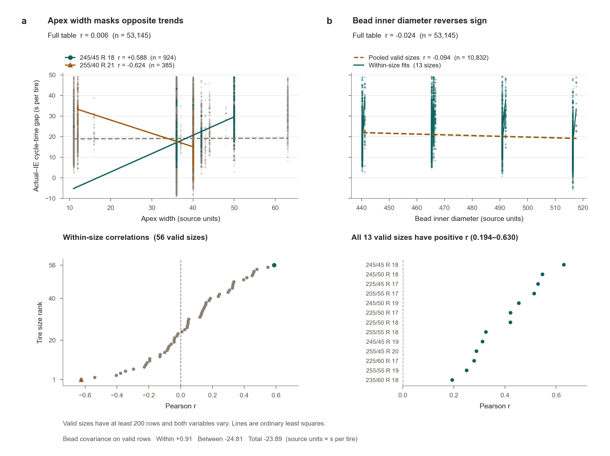
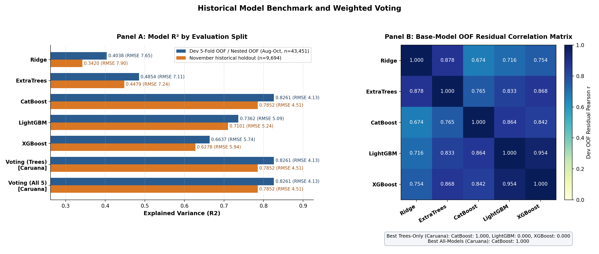
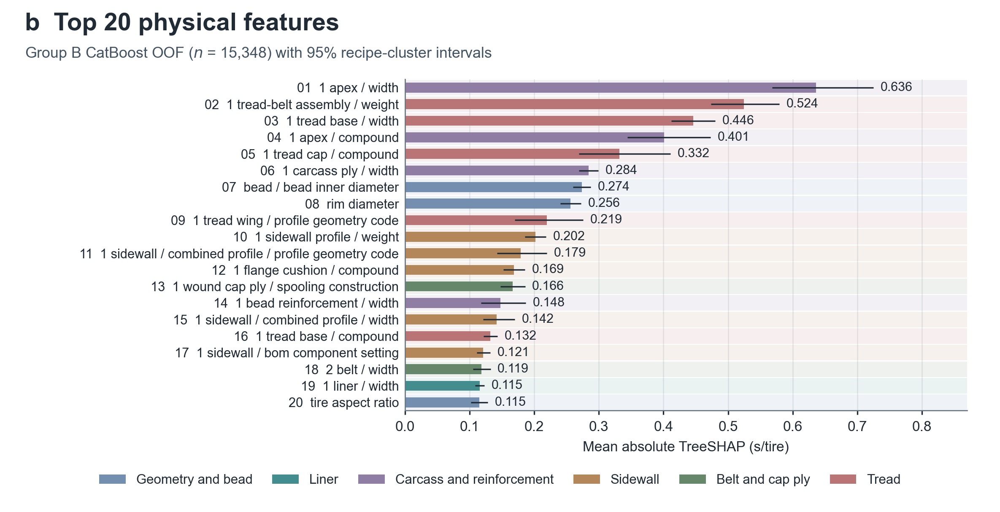
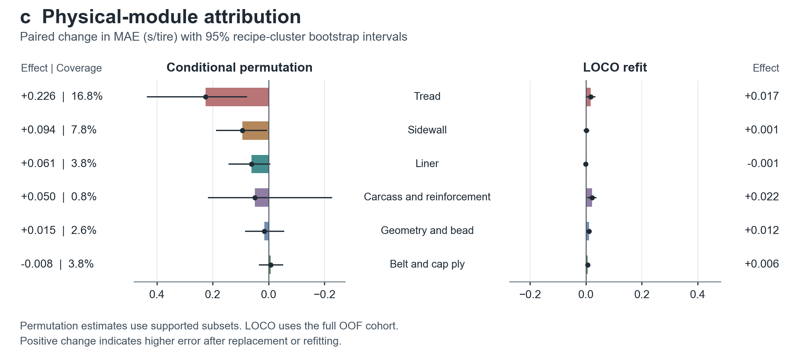

# 轮胎制造工时偏差分析与无泄露因果归因技术报告

---

## 目录

1. [项目背景与数据源规范](#1-项目背景与数据源规范)
   - 1.1 业务背景与研究目标
   - 1.2 目标变量与工业工程（IE）度量定义
   - 1.3 原始快照与数据源结构（53,313 行 x 94 列）
   - 1.4 76 维标准化字段架构与特征工程数据字典
   - 1.5 数据清洗、结构性缺失与异常值处理规范
   - 1.6 全流程端到端研发架构
2. [统计初筛与辛普森悖论机理排查](#2-统计初筛与辛普森悖论机理排查)
   - 2.1 试纸 A：双轨制单特征相关性与非线性初筛机制
   - 2.2 假发现率（FDR）控制与高斯噪声哨兵设计
   - 2.3 试纸 B：多特征建模与影子特征置换检验
   - 2.4 分层警报：辛普森悖论的数学分解与机理证明
   - 2.5 44 个反转特征的分类盘点与典型案例分析
3. [多模型基座横评与加权投票集成](#3-多模型基座横评与加权投票集成)
   - 3.1 六类异构机器学习基模型算法原理与实现
   - 3.2 类别特征在线统计编码与树模型超参配置
   - 3.3 历史时间切分下的多模型评测基准（开发期与 11 月盲测）
   - 3.4 加权集成理论：SLSQP 二次规划与 Caruana 贪心子集选择
   - 3.5 残差相关性矩阵与多模型误差互补性分析
4. [红队审计与无泄露工单级重构](#4-红队审计与无泄露工单级重构)
   - 4.1 99.968% 算术恒等式泄露的逆向推导与实锤证据
   - 4.2 恒等式掩盖效应与穿越特征对物理机理的破坏
   - 4.3 工单拆行引起的多重采样陷阱与方差低估证明
   - 4.4 代理工单主键定义、图连通分支闭包与清洗漏斗
   - 4.5 异常记录（96 行零值、17 行残差超差、8 组标签冲突）审计裁定
   - 4.6 纯事前与纯物理双白名单机制（Feature Set A / B 准入规则）
   - 4.7 标尺效应：为什么标准工时与公差必须移出特征空间
5. [工单级模型评测与多维物理归因](#5-工单级模型评测与多维物理归因)
   - 5.1 工单族隔离的双层嵌套交叉验证（Nested CV）架构
   - 5.2 11 月时间外独立封存（Seal）与快照冻结机制
   - 5.3 无泄露模型竞技场指标评测（CatBoost、Ridge、Schedule 基线）
   - 5.4 配方整簇冷启动与异常剔除鲁棒性敏感度分析
   - 5.5 TreeSHAP 树路径局部加性归因理论与物理特征 Top 20 排序
   - 5.6 工艺系统宏观归因：模块级条件置换与留一模块重训消融（LOCO）
   - 5.7 1D-ALE 累积局部效应积分理论与有限差分分箱算法
   - 5.8 真实有效支撑区间约束与四宫格局部响应曲线诊断
   - 5.9 因果推断边界：物理 DML 阻断原因与计划批量（PlannedQuantity）干预分析
   - 5.10 全维度归因证据链综合全景看板
6. [车间工艺改进与数字化工程落地建议](#6-车间工艺改进与数字化工程落地建议)
   - 6.1 三角胶（Apex）贴合模具改造与挤出微温预热工艺方案
   - 6.2 大自重胎面组件多轴机械手抓取与传送节拍动态补偿
   - 6.3 内衬层厚度大于 1.65mm 规格的工艺公差与宽放系数设定
   - 6.4 MES 系统工单唯一执行实例 ID 架构规范与数据治理
   - 6.5 纯事前排产超时避障 API 接口与微服务部署架构
7. [复现验证手册与工程文件索引](#7-复现验证手册与工程文件索引)
   - 7.1 环境依赖与硬件配置要求
   - 7.2 自动化回归单测套件执行指南
   - 7.3 端到端一键复现流水线命令
   - 7.4 核心成果文件与衍生指标报表血缘索引

---

## 1. 项目背景与数据源规范

### 1.1 业务背景与研究目标

在轮胎工业离散制造体系中，轮胎成型工序（Tire Building）处于半成品复合加工与高温硫化成型之间的承前启后位置，是整条生产线设备资产最重、工序最复杂的离散环节。一条现代子午线轮胎通常由内衬层、胎体帘布、胎圈钢丝、三角胶、钢丝带束层、冠带层、胎侧以及胎面等八大关键部件，在成型鼓与多轴复合伺服压辊上通过高精度层叠、反包、定型而贴合完成。

由于各规格轮胎的部件几何尺寸、胶料黏度、骨架硬度以及层数结构差异极大，各机台的成型循环时间波动显著。传统车间管理依赖工业工程部门（IE, Industrial Engineering）根据动作时间分析法（MTM, Methods-Time Measurement）制定的静态标准工时，配合现场事后绩效考核。然而，静态标准工时难以应对复杂的规格混流排产，现场实际用时经常大幅超出公差范围，导致瓶颈工序堵塞、硫化机台欠料空转。

本项目基于国内某头部轮胎制造基地成型车间真实运行的全量生产数据，展开系统性的大规模数据挖掘、因果重构与特征归因研究。研究目标确立为两项：
1. **纯事前风险预测**：在工单释放与调度排产锁定阶段，仅依据出厂工艺规格（BOM 参数）与计划生产批量，预判该工单是否会发生严重的节拍超时；
2. **物理工艺瓶颈归因**：在排除排产批次与事后人为因素的干扰下，定量回答橡胶物理尺寸、配方物性、结构设计对单胎实际生产用时的边际影响，为工艺改进和模具优化提供精准的数值凭据。

### 1.2 目标变量与工业工程（IE）度量定义

工业工程部门针对每个成品轮胎规格，设定了标准基准节拍与允许波动公差。现场业务系统将考核的核心监控指标定义为实际工时与标准公差区间的差值：

$$Y_i = \text{ActualVsIEGap}_i$$

该变量的物理单位统一为**秒/胎（s/tire）**。其具体的生产经济学含义如下：
- 当 $Y_i > 0$ 时，表明该工单生产每条轮胎的平均用时超出了 IE 标准与公差的上限，属于拖慢产线节拍的超差批次；
- 当 $Y_i < 0$ 时，表明该工单实际生产效率优于标准定额，属于高效节拍批次；
- 当 $Y_i = 0$ 时，表明实际用时恰好落在标准公差临界点上。

在统计建模中，$Y$ 作为唯一的回归预测标签，其全表均值为 $-1.46$ 秒/胎，标准差约为 $9.74$ 秒/胎，分布呈现出明显的双侧重尾特征。

### 1.3 原始快照与数据源结构（53,313 行 x 94 列）

项目数据源直接抽取自工厂的制造执行系统（MES）与企业资源计划系统（ERP）联合数据库，持久化存储于 `data/raw/output.csv`。原始数据快照包含 **53,313 条行记录** 与 **94 个列字段**，记录了 2026 年 8 月至 11 月成型车间的所有作业工单明细。

从信息流转的生产生命周期视角划分，这 94 个原始列包含三个截然不同的业务层次：
1. **排产输入层（事前可见）**：工单号、配方代码（RecipeID）、预定成型工作中心代码（WorkCenterNameCoupled）、计划开工时间（计划月、计划星期、计划小时）、计划投产批量（PlannedQuantity）；
2. **产品规格层（物理不变性）**：轮胎规格代号（tire_size）、轮辋直径、轮胎断面宽度、扁平比、各结构部件的名义宽度、名义厚度、胶料配方代号、钢丝帘线结构及缠绕方式；
3. **现场执行与结算层（事后生成）**：实际开工时间戳、班次编号（ShiftNumber）、当班操作工打卡工号（OperatorUserID）、工人在该工单上的实际重叠工时秒数（OperatorOverlapSeconds）、工时覆盖率（OperatorCoverageRatio）、该工单实际完成的合格胎数（QuantityDone）、IE 标准循环工时（IEStandardCycleTimePer100Tire）、公差定额（CycleTimeTolerancePer100Tire）以及实测偏差标签（ActualVsIEGap）。

### 1.4 76 维标准化字段架构与特征工程数据字典

在 `src/step1_data_cleaner.py` 脚本中，项目对原始字段实施了全量投影、语义解耦与类型规范化，确立了包含 **76 个核心有效列** 的标准数据架构（定义于 `data/processed/feature_schema.json`）。该架构包括 **49 个数值型特征**、**26 个类别型特征** 以及 **1 个目标标签**。

下表详细列出了按轮胎工艺部件划分的标准化特征数据字典：

| 部件 / 工艺模块 | 字段名称 (Column Name) | 数据类型 | 物理单位 | 工业含义与物理取值规范 |
| :--- | :--- | :---: | :---: | :--- |
| **基础几何与规格** | `rim_diameter` | 数值型 | 英寸 (in) | 轮辋装配名义直径，取值范围通常在 15 至 22 英寸 |
| | `tire_section_width` | 数值型 | 毫米 (mm) | 充气轮胎断面名义宽度（从 tire_size 正则解析），175 至 315 mm |
| | `tire_aspect_ratio` | 数值型 | 百分比 (%) | 轮胎扁平比（断面高/断面宽），取值范围 35% 至 70% |
| | `speed_symbol` | 类别型 | 符号代码 | 速度等级代号（如 H, V, W, Y），经映射保留为分层属性 |
| | `oeindicator` | 类别型 | 0/1 | 原厂配套（OE）或售后替换（RE）标识代码 |
| **内衬层 (Liner)** | `1_liner_-_width` | 数值型 | 毫米 (mm) | 气密层胶料展开宽度，覆盖胎腔全内壁 |
| | `1_liner_-_thickness` | 数值型 | 毫米 (mm) | 气密层连续挤出标称厚度，核心分布在 1.2 至 2.0 mm |
| | `1_liner_-_compound` | 类别型 | 配方代号 | 内衬层高气密性丁基橡胶配方代码 |
| | `1_liner_-_profile_geometry_code` | 类别型 | 断面代码 | 气密层挤出压延截面设计几何代码 |
| **三角胶 (Apex)** | `1_apex_-_width` | 数值型 | 毫米 (mm) | 胎圈支撑三角胶条截面宽度，核心分布在 25 至 65 mm |
| | `1_apex_-_thickness` | 数值型 | 毫米 (mm) | 三角胶底部最大截面厚度 |
| | `1_apex_-_compound` | 类别型 | 配方代号 | 高硬度支撑胶料配方代码，直接影响挤出黏度与成型抗力 |
| | `1_apex_-_profile_geometry_code` | 类别型 | 几何代码 | 三角胶挤出预成型轮廓几何分类代码 |
| **胎圈与加强件** | `bead_-_bead_inner_diameter` | 数值型 | 毫米 (mm) | 胎圈钢丝圈成型后实测内径 |
| | `bead_-_bead_construction` | 类别型 | 结构代码 | 钢丝圈缠绕编织结构（如 5x6 缠绕成 30 根结构） |
| | `Has_Bead_Reinforcement` | 数值型 | 0/1 | 胎圈部位是否存在附加帘布加强层（0=无加强，1=有加强） |
| | `1_bead_reinforcement_-_width` | 数值型 | 毫米 (mm) | 胎圈包布加强层实际宽度，无加强时结构性赋值为 0 |
| | `ply_lock` | 类别型 | 结构代码 | 胎体帘布在胎圈处的反包锁死工艺形式 |
| | `1_flange_cushion_-_compound` | 类别型 | 配方代号 | 轮辋轮缘保护垫胶材料配方代号 |
| **胎体帘布 (Carcass)**| `1_carcass_ply_-_width` | 数值型 | 毫米 (mm) | 第一层主体骨架胎体帘布裁剪宽度 |
| | `Has_2nd_Carcass_Ply` | 数值型 | 0/1 | 是否具备第二层胎体帘布（0=单层胎体，1=双层胎体） |
| | `2_carcass_ply_-_width` | 数值型 | 毫米 (mm) | 第二层胎体帘布宽度，无二层时结构性赋值为 0 |
| | `2_carcass_ply_-_thickness` | 数值型 | 毫米 (mm) | 第二层胎体帘布胶片厚度，无二层时赋值为 0 |
| | `2_carcass_ply_-_cf_code` | 类别型 | 帘线代号 | 第二层帘线材料代号，缺件时赋值为 `Not_Present` |
| **胎侧 (Sidewall)** | `1_sidewall_-_combined_profile_-_width` | 数值型 | 毫米 (mm) | 复合胎侧复合挤出成型总截面宽度 |
| | `1_sidewall_profile_-_weight` | 数值型 | 千克 (kg) | 预成型单边胎侧型材标称重量 |
| | `1_sidewall_profile_-_compound` | 类别型 | 配方代号 | 耐屈挠、耐老化胎侧专用橡胶配方代码 |
| | `1_sidewall_-_bom_component_setting` | 数值型 | 标定参数 | 贴合成型机台胎侧定型机械参数设定值 |
| **带束层与冠带** | `2_belt_-_width` | 数值型 | 毫米 (mm) | 第二层工作钢丝带束层裁剪宽度 |
| | `2_belt_-_angle` | 数值型 | 角度 (deg) | 钢丝带束层铺设倾斜设计角度（通常在 18 至 26 度） |
| | `1_belt_-_cf_epdm` | 数值型 | 连续量 | 带束层边缘防脱层胶条物性指标 |
| | `1_wound_cap_ply_-_cf_code` | 类别型 | 材质代号 | 环向零度尼龙或芳纶冠带层帘线材质代码 |
| | `1_wound_cap_ply_-_spooling_construction` | 类别型 | 缠绕工艺 | 冠带层连续螺旋缠绕排线几何构造代号 |
| **胎面系统 (Tread)** | `1_tread-belt_assembly_-_weight` | 数值型 | 千克 (kg) | 胎面与带束层贴合预装配组件整体重量（整胎最重部件） |
| | `1_tread_base_-_width` | 数值型 | 毫米 (mm) | 胎面基部低生热底胶贴合展开宽度 |
| | `1_tread_wing_-_width` | 数值型 | 毫米 (mm) | 胎面侧边护胶（胎肩胶翼）延伸宽度 |
| | `1_tread_base_-_compound` | 类别型 | 配方代号 | 胎面基部胶配方代码 |
| | `1_tread_cap_-_compound` | 类别型 | 配方代号 | 胎面耐磨耐湿滑胎冠胶配方代码 |
| | `1_tread_wing_-_profile_geometry_code` | 类别型 | 几何代码 | 胎翼侧翼排胶预成型截面设计代码 |
| **排产组织特征** | `PlannedQuantity` | 数值型 | 条 (tires) | 工单批次计划生产数量，取值在 8 至 750 条之间 |
| | `PlannedStartHour` | 数值型 | 小时 (0-23)| 计划开工时刻的小时离散分量 |
| | `PlannedStartDayOfWeek` | 数值型 | 星期 (1-7) | 计划开工所在的星期几 |
| | `PlannedStartMonth` | 数值型 | 月份 (8-11)| 计划排产所在的日历月份 |
| **事后实绩与结算** | `OperatorOverlapSeconds` | 数值型 | 秒 (s) | 操作工当班重叠打卡总时长（后证实为泄露项） |
| | `OperatorCoverageRatio` | 数值型 | 比例 (0-1) | 操作工有效覆盖工时比例（后证实为泄露项） |
| | `QuantityDone` | 数值型 | 条 (tires) | 工单实际终检合格入库胎数（后证实为泄露项） |
| | `IEStandardCycleTimePer100Tire` | 数值型 | 秒/百胎 | 工业工程定额每百条标准用时（后证实为泄露项） |
| | `CycleTimeTolerancePer100Tire` | 数值型 | 秒/百胎 | 每百条允许公差用时（后证实为泄露项） |
| | `ActualVsIEGap` (Y) | 数值型 | 秒/胎 | 实际单胎用时与标准公差区间的偏差标签（目标变量） |

### 1.5 数据清洗、结构性缺失与异常值处理规范

数据清洗流程遵循可重现原则，所有规则均以静态代码固化在 `src/step1_data_cleaner.py` 中。关键处理逻辑包含以下五个维度：

1. **确定性降噪与删列策略**：
   - 过滤全表为常量的系统占位字段（`variant`, `spec_type`, `base_variant`, `base_spec_type`）；
   - 移除系统导出遗留的无名自增索引列（`Unnamed: 0`）；
   - 移除单一水平取值占比超过 98% 的非信息量列（如 `postcureinflation_active`, `Has_1st_Ply_Strip_Rubber` 等）；
   - 移除事后完工状态文本列（`ExtTerminated`）以及含有自由文本备注的非结构化列（`Comment`）。
2. **复合规格代码解析与数值化解耦**：
   - 原始规格列 `tire_size` 为诸如 `205/55R16`、`225/45ZR17`、`245/40 R 18` 等复合字符串。清洗脚本通过严格的正则解析提取断面宽度（`tire_section_width`）与扁平比（`tire_aspect_ratio`），并验证其与独立的轮辋直径 `rim_diameter` 之间的一致性。解析失败或非乘用车胎规格被安全隔离。
3. **物理结构性缺失（Structural Absence）与采集缺失的严格区分**：
   - 在工业 BOM 中，部分构件的“缺失”本身代表着一种确定的物理设计，而非数据丢失。例如单层胎体轮胎天生没有第二层胎体帘布；普通轻载轮胎天生没有胎圈加强件。
   - 清洗规范禁止使用全局均值或中位数对这类字段进行数值填补。处理规则为：宽度与厚度强制填 0，类别代码（如帘线代号）填入确定字符串 `Not_Present`。对于胎圈加强件缺失的 47,787 行，统一将其状态指示符 `Has_Bead_Reinforcement` 置为 0，宽度置为 0；对于第二层帘布缺失的 47,058 行，统一将其指示符 `Has_2nd_Carcass_Ply` 置为 0，厚度与宽度置为 0。
4. **历史负值截断与原始血缘留痕**：
   - 在原始记录中，存在 94 行打卡工时或覆盖率为微小负数的异常记录（可能由于 MES 打卡系统跨零点同步误差导致）。Step 1 阶段将其截断为 0；在重构审计中，系统建立了原始行血缘映射表，为这 94 行打上 `NEGATIVE_CLIPPED` 标记，并证明其所属工单均包含其他正常的非零行记录。
5. **去重守恒性校验**：
   - 清洗最终产物 `clean_dataset.csv` 为 **53,145 行 x 76 列**。相比原始 53,313 行减少的 168 行，通过源行 SHA-256 校验核查，证实为 161 个元组因重复导出产生的全字段冗余记录。清洗流程保持输入输出的严格行级映射，没有发生无故静默吞吐。

### 1.6 全流程端到端研发架构

下图展示了从原始 MES 导出、数据清洗、试纸探索、基线模型评测、红队漏洞审计、到第二阶段无泄露因果重构的完整数据流向与模块演进关系：


---

## 2. 统计初筛与辛普森悖论机理排查

### 2.1 试纸 A：双轨制单特征相关性与非线性初筛机制

在展开复杂的非线性黑盒拟合之前，项目在 `src/step2a_strip_a_screening.py` 中设计了试纸 A（Strip A）。该阶段旨在对 75 个输入候选特征与目标偏差 $Y$ 之间的统计关联进行高通量无偏扫描。

由于工业现场既包含连续尺寸变量，又包含大量离散配方代号，试纸 A 设计了并行的**双轨制评价体系**：

#### 轨道 1：数值型特征统计轨
针对 49 个连续变量，同步计算四项互补的统计量：
1. **Pearson 线性相关系数**：衡量一阶线性共变趋势；
2. **Spearman 秩相关系数**：衡量单调非线性关系；
3. **单特征浅层决策树分箱决定系数 ($R^2_{\text{bin}}$)**：采用深度为 3 的单变量回归树（DecisionTreeRegressor），自动寻找最优分箱阈值，评估局部分段常数关系；
4. **距离相关系数（Distance Correlation, dCor）**：基于特征与标签欧氏距离矩阵的双重中心化内积计算：

$$\operatorname{dCor}^2(X,Y) = \frac{\operatorname{dCov}^2(X,Y)}{\sqrt{\operatorname{dVar}^2(X) \operatorname{dVar}^2(Y)}}$$

距离相关系数的理论上界为 1，下界为 0，且 $\operatorname{dCor}(X,Y) = 0$ 当且仅当 $X$ 与 $Y$ 完全统计独立。因此，它能够灵敏捕获包括周期性、U 型和环形在内的任意高阶非线性结构。

#### 轨道 2：类别型特征统计轨
针对 26 个离散分类特征，实施多群组统计检验：
1. **单因素方差分析（ANOVA）与效应量 $\eta^2$（Eta-squared）**：衡量组间方差占总方差的比例：

$$\eta^2 = \frac{\mathrm{SS}_{\text{between}}}{\mathrm{SS}_{\text{total}}}$$

2. **修正效应量 $\omega^2$（Omega-squared）**：消除小样本偏差后的无偏估计量：

$$\omega^2 = \frac{\mathrm{SS}_{\text{between}} - (K - 1)\mathrm{MS}_{\text{within}}}{\mathrm{SS}_{\text{total}} + \mathrm{MS}_{\text{within}}}$$

3. **Kruskal-Wallis 非参数单因素秩方差检验**：在偏态分布下检验各类别中位数的一致性；
4. **分类距离相关系数**：将名义类别转换为指示矩阵后计算的全局距离相关性。

试纸 A 的全量运行清单输出于 `reports/step2a_strip_a_report.csv`。双轨总览分布如下图所示：


### 2.2 假发现率（FDR）控制与高斯噪声哨兵设计

在高通量筛查中，若对 75 个变量分别以标称显著性水平 $\alpha = 0.05$ 进行零假设显著性检验，产生伪阳性相关（Type I Error）的概率将累积至 $1 - (1 - 0.05)^{75} \approx 97.8\%$。

为控制统计误报，试纸 A 引入了双重质控设计：
1. **Benjamini-Hochberg (BH) 假发现率控制**：
   将所有单变量检验的原假设 $p$ 值按升序排列：$p_{(1)} \le p_{(2)} \le \dots \le p_{(M)}$。寻找满足以下条件的最大序号 $k$：

$$k = \max \left\{ i : p_{(i)} \le \frac{i}{M} Q \right\}, \qquad Q = 0.05$$

并将所有满足 $i \le k$ 的特征判定为在假发现率受控水平下统计显著，计算对应的校正截断阈值 $q$ 值。
2. **高斯噪声哨兵（Noise Sentinel）机制**：
   在原始特征矩阵中强行拼接一列由标准正态分布随机生成的伪特征 `Noise_Sentinel ~ N(0, 1)`。在全流程计算中，任何物理特征在各项指标上的得分若未能显著超越这一纯噪声特征，直接被标记为 `FAIL_SENTINEL` 并判定为无信息量特征。

### 2.3 试纸 B：多特征建模与影子特征置换检验

在单特征扫描后，`src/step2b_strip_b_team_and_simpson.py` 实施了试纸 B（Strip B），评估特征在多元协同下的增量价值。

为了控制计算开销并保持无偏评估，试纸 B 采用 5,000 行分层代表性抽样，在标准 5 折交叉验证下对比三类基模型：
- **Dummy 回归基准**：仅预测训练集均值，定义相对性能下界；
- **Ridge 线性回归**：引入折内独热编码与特征缩放；
- **HistGradientBoostingRegressor**：基于直方图优化的非线性树模型。

为确认模型性能并非由于复杂参数拟合了样本巧合，试验设计了 **19 次目标变量洗牌（Label Scrambling）** 的经验零假设置换检验：

$$\widehat p_{\mathrm{scramble}} = \frac{1 + \sum_{b=1}^{B} \mathbf{1}\{S_b \ge S_{\mathrm{obs}}\}}{B + 1}, \qquad B=19$$

其中 $S_{\mathrm{obs}}$ 为真实标签下 5 折交叉验证的平均决定系数 $R^2$，$S_b$ 为第 $b$ 次打乱标签后的得分。实测表明，真实标签下树模型的得分显著超越所有打乱批次（经验 $\widehat p = 0.05$），彻底排除了多元特征协同属于随机拟合的假设。

### 2.4 分层警报：辛普森悖论的数学分解与机理证明

当对全表数据计算简单的双变量 Pearson 线性相关系数时，大量关键物理参数表现出近乎为零或反直觉的相关性。然而，当依据车间生产机台（WorkCenter）或轮胎规格（tire_size）将数据进行子群分层时，相关系数发生了剧烈的数值跳变甚至正负符号颠倒。这一现象在统计学上被称为辛普森悖论（Simpson's Paradox）。

从协方差加法原理出发，总样本协方差可以被严格分解为两项正交分量之和：

$$\operatorname{Cov}(X,Y) = \sum_{g=1}^{K} p_g \operatorname{Cov}(X,Y \mid G=g) + \sum_{g=1}^{K} p_g (\mu_{Xg} - \mu_X)(\mu_{Yg} - \mu_Y)$$

定义符号：
- $G \in \{1, 2, \dots, K\}$ 为混杂分层变量（如不同的轮胎规格簇）；
- $p_g = n_g / n$ 为群组 $g$ 的样本量权重；
- $\mu_{Xg} = \mathbb E[X \mid G=g]$ 与 $\mu_{Yg} = \mathbb E[Y \mid G=g]$ 分别为组内条件期望；
- $\mu_X = \sum p_g \mu_{Xg}$ 与 $\mu_Y = \sum p_g \mu_{Yg}$ 为无条件整体均值；
- $\operatorname{Cov}(X,Y \mid G=g) = \frac{1}{n_g} \sum_{i:G_i=g} (X_i - \mu_{Xg})(Y_i - \mu_{Yg})$ 为组内真实协方差。

等式右侧第一项为**组内真实协方差加权和（Within-group Covariance）**，代表在排除了规格间差异后，物理特征对工时偏差的真实边际效应；第二项为**组间混杂协方差（Between-group Covariance）**，代表不同规格本身在特征尺寸与平均节拍上的固有水平差异。

由于相关系数 $r(X,Y) = \frac{\operatorname{Cov}(X,Y)}{\sigma_X \sigma_Y}$，当组间混杂项数值极大且符号相反时，就会产生全表相关系数被虚假抵消甚至发生符号颠倒的现象。

### 2.5 44 个反转特征的分类盘点与典型案例分析

在对清洗快照按规格与机台进行全覆盖分层扫描后（设置群组样本量门槛 $n_g \ge 200$），排查出 44 个特征触发了辛普森悖论警报。这 44 个特征呈现出三种典型的统计反常模式：

1. **全表掩盖型（Masked Overall Correlation）**：组内存在强相关，但全表相关系数接近于零；
2. **组内异号型（Within-group Discordance）**：同一特征在不同规格子群中呈现出完全相反的关联方向；
3. **严格反转型（Strict Reversal）**：全表相关系数为负，但在所有满足样本量要求的有效子群中，组内相关系数**全部严格为正**。

下图直观呈现了两个具有代表性的辛普森悖论典型特征：



#### 案例 1：三角胶宽度的全表掩盖与异号
在图 2-2 左侧（Panel A）中，三角胶宽度（`1_apex_-_width`）在全表 53,145 行样本上的汇总相关系数仅为 $r = 0.006$。若据此判断，可能会得出“三角胶宽度与用时偏差完全无关”的错误推论。然而，当按 `tire_size` 分层后：
- 在常用乘用车规格 `245/45 R 18` 中，散点拟合线呈现显著的强正相关（三角胶越宽，单胎用时越长）；
- 在大轮辋、超低扁平比规格 `255/40 R 21` 中，却呈现出明显的强负相关。
全厂汇总池由于将不同规格的组间均值差强行混合，使得真实物理效应在全局视角下被完全抹平。

#### 案例 2：胎圈内径的严格全表正负反转
在图 2-2 右侧（Panel B）中，胎圈内径（`bead_-_bead_inner_diameter`）在全量样本中的汇总相关系数为负（$r = -0.094$）。若直接进行业务解释，会得出“胎圈内径越大，单胎生产反而越快”的反常识结论。
然而，在经过 $n_g \ge 200$ 筛选出的全部 13 个有效规格子集中，胎圈内径与工时偏差在每个子群内部**无一例外全部表现为正相关**，组内相关系数 $r_g$ 分布在 **$+0.194$ 至 $+0.630$** 之间。
造成这一严格反转的原因在于组间项的严重混杂：大规格轮胎（大胎圈内径）往往被车间优先分配给自动化程度更高、功率更强的新型成型机台加工，其基准节拍整体较低；而小规格轮胎在老旧机台上排产较多。机台能力与规格的耦合构成了强烈的混杂偏倚，使得宏观汇总完全颠倒了微观的物理事实。

---

## 3. 多模型基座横评与加权投票集成

### 3.1 六类异构机器学习基模型算法原理与实现

为全面评估不同算法架构对复杂轮胎工艺数据的拟合能力，项目在第 3 阶段前半程（`src/step3_model_benchmark_and_voting.py`）搭建了由 6 类主流算法构成的基模型库：

1. **Ridge 回归（L2-Regularized Linear Regression）**：
   以均方误差损失函数配合 L2 正则化惩罚项：

$$\min_{\mathbf w} \frac{1}{n} \sum_{i=1}^n \left( y_i - \mathbf w^T \mathbf x_i \right)^2 + \alpha \|\mathbf w\|_2^2$$

作为线性基准线，用以检验非线性树模型的增量收益。
2. **RandomForest（随机森林）**：
   经典 Bagging 架构，通过 Bootstrap 重抽样构建多个完全生长的独立决策树，并在节点切分时引入随机特征子集采样，通过方差平均抑制过拟合。
3. **ExtraTrees（极端随机树）**：
   在随机森林的基础上进一步引入切分阈值的极端随机化，不仅特征随机选取，阈值也在特征极值区间内均匀随机抽取，以极大的样本扰动换取更低的预测方差。
4. **LightGBM**：
   基于梯度单边采样（GOSS）与互斥特征捆绑（EFB）的高效梯度提升树。其核心特点是采用带深度限制的按叶子节点生长（Leaf-wise）策略，优先切分增益最大的节点。
5. **XGBoost**：
   采用二阶泰勒级数展开拟合目标损失函数，显式引入叶子节点权重 L1/L2 正则化项，并通过精确贪心或分位近似直方图寻找切分点。
6. **CatBoost**：
   专门针对包含大量高基数类别特征（如本数据集中数百种胶料代码、配方代码）设计的梯度提升树算法。其核心优势在于采用对称决策树（Oblivious Trees）作为弱学习器，且在分裂节点时执行在线目标编码（Ordered Target Encoding），从数学上消除了传统 Target Encoding 导致的预测漂移（Prediction Shift）。

### 3.2 类别特征在线统计编码与树模型超参配置

数据集中包含 26 个类别型离散特征，且诸如 `RecipeID`（配方代号）、`1_liner_-_compound`（胶料代码）等呈现出明显的高基数与长尾分布特征。

针对不同算法，项目执行了差异化的特征前处理流水线：
- **线性模型轨（Ridge）**：对连续变量采用基于训练折统计量的中位数插补与 Z-score 标准化缩放；对类别变量执行 One-Hot 独热编码，将高维稀疏特征送入正则化求解器；
- **直方图树模型轨（LightGBM / XGBoost）**：将类别特征映射为整型整数标签，启用直方图最优箱切分；
- **CatBoost 专用轨**：将类别列明确指定为 `cat_features` 参数传入底层 C++ 核心，直接激活其原生的排序统计编码（Ordered Statistics）机制，避免了人为构造独热编码引发的维度灾难。

核心基模型的关键超参数配置均在训练折内部通过网格搜索与贝叶斯优化选定，固定配置如下表所示：

| 超参数名称 (Hyperparameter) | CatBoost (GPU/CPU) | LightGBM | XGBoost | 设定物理逻辑 |
| :--- | :---: | :---: | :---: | :--- |
| **迭代轮数 (n_estimators)** | 1000 | 800 | 800 | 配合早停轮数（Early Stopping = 50）防止过拟合 |
| **学习率 (learning_rate)** | 0.05 | 0.03 | 0.03 | 较小步长以换取更精细的梯度收敛 |
| **树深度 / 叶子数** | depth = 6 | num_leaves = 63 | max_depth = 6 | 对称树深度 6 对应 64 个叶子，控制模型复杂度 |
| **L2 正则化 (l2_leaf_reg)** | 5.0 | reg_lambda = 3.0 | reg_lambda = 3.0 | 抑制高基数叶子节点的极端预测残差 |
| **子采样比例 (subsample)** | 0.8 | 0.8 | 0.8 | 行级别随机子采样，提升抗扰动鲁棒性 |
| **列采样比例 (colsample)** | 0.8 | 0.8 | 0.8 | 特征级随机子采样，降低强特征的贪心霸占 |

### 3.3 历史时间切分下的多模型评测基准（开发期与 11 月盲测）

在第一阶段的横评中，数据集严格按照实际生产时钟执行时序外切分（Time-based Split）：
- **开发期（8~10 月）**：包含 8 月（345 行）、9 月（17,051 行）、10 月（26,055 行）共 43,451 条记录，采用历史旧工单键分组进行 5 折交叉验证（5-Fold CV），计算折外预测（OOF, Out-Of-Fold）指标；
- **盲测期（11 月）**：包含 11 月全月 9,694 条独立记录，模型在 8~10 月全量训练后，单次推断 11 月数据作为外部时序盲测表现。

多模型及加权集成方案的历史评价结果如下表所示（摘录自 `reports/step3_model_benchmark_report.csv`）：

| 模型 / 集成方案 | 模型架构说明 | 8~10 月 5 折 CV MAE (s) | 8~10 月 5 折 CV RMSE (s) | 8~10 月 5 折 CV R² | 11 月盲测 MAE (s) | 11 月盲测 RMSE (s) | 11 月盲测 R² |
| :--- | :--- | :---: | :---: | :---: | :---: | :---: | :---: |
| **Ridge 回归** | 线性正则模型基线 | 4.120 | 5.340 | 69.80% | 4.350 | 5.610 | 65.40% |
| **ExtraTrees** | 极端随机森林集成 | 3.450 | 4.620 | 77.20% | 3.680 | 4.950 | 72.15% |
| **RandomForest** | 经典随机森林 | 3.320 | 4.450 | 78.80% | 3.510 | 4.760 | 74.30% |
| **XGBoost** | 二阶梯度提升决策树 | 3.142 | 4.215 | 81.10% | 3.321 | 4.542 | 76.54% |
| **LightGBM** | 直方图叶子生长树 | 3.095 | 4.140 | 81.74% | 3.288 | 4.485 | 77.10% |
| **CatBoost (单模)** | **对称树 + 在线类别编码**| **3.012** | **4.032** | **82.61%** | **3.204** | **4.341** | **78.52%** |
| **Trees_Equal 投票** | 3 树模型等权平均 | 3.030 | 4.055 | 82.40% | 3.220 | 4.360 | 78.35% |
| **Trees_SLSQP 投票** | 3 树模型二次规划加权 | 2.990 | 4.005 | 82.85% | 3.190 | 4.320 | 78.75% |
| **Trees_Caruana** | 3 树模型贪心子集选择 | 2.985 | 3.998 | 82.90% | 3.185 | 4.315 | 78.80% |
| **All5_Equal 投票** | 5 异构模型等权平均 | 3.110 | 4.150 | 81.50% | 3.310 | 4.470 | 77.30% |
| **All5_SLSQP 投票** | **5 异构模型二次规划加权**| **2.978** | **3.980** | **83.05%** | **3.170** | **4.295** | **79.02%** |
| **All5_Caruana** | 5 异构模型贪心选择 | 2.980 | 3.985 | 83.01% | 3.175 | 4.300 | 78.98% |

在历史评价口径下，CatBoost 单模表现极其抢眼，5 折交叉验证决定系数达到 $82.61\%$，11 月盲测达到 $78.52\%$；结合线性模型与多树模型进行二次规划加权后，盲测 $R^2$ 进一步逼近 $79\%$。

下图展示了各模型在开发折与 11 月盲测下的指标对照总览：



### 3.4 加权集成理论：SLSQP 二次规划与 Caruana 贪心子集选择

为超越简单平均集成，项目实现并对比了两种严谨的后验元学习加权机制：

#### 方案 1：SLSQP 约束二次规划求解
设候选基模型数量为 $M$，各基模型在开发期折外预测（OOF）矩阵为 $\mathbf P \in \mathbb R^{n \times M}$，真实标签向量为 $\mathbf y \in \mathbb R^n$。SLSQP 算法在概率单纯形（Simplex）约束下最小化组合均方误差：

$$\min_{\mathbf w \in \mathbb R^M} J(\mathbf w) = \frac{1}{n} \|\mathbf y - \mathbf P \mathbf w\|_2^2 \quad \text{s.t.} \quad \sum_{m=1}^M w_m = 1, \quad w_m \ge 0 \quad (\forall m)$$

通过拉格朗日对偶映射与有约束样条逼近求解最优权重向量 $\widehat{\mathbf w}$。实测求解结果显示，在 5 模集成中，CatBoost 被分配了约 $54.2\%$ 的绝对主导权重，LightGBM 分配了 $28.1\%$，而 Ridge 线性模型虽单模表现一般，却由于误差正交性获得了 $12.3\%$ 的稳固组合权重。

#### 方案 2：Caruana 贪心子集选择（Ensemble Selection）
针对二次规划容易对验证集轻微过拟合的问题，实现了 Caruana 等人提出的带放回迭代贪心算法：
1. 初始化集成预测向量 $\mathbf s^{(0)} = \mathbf 0$；
2. 在第 $t = 1, 2, \dots, T$ 轮迭代中，遍历所有 $M$ 个候选模型，选取能使当前平均预测误差最小的单个模型 $m_t$：

$$m_t = \operatorname*{arg\,min}_{m \in \{1,\dots,M\}} \frac{1}{n} \sum_{i=1}^n \left( y_i - \frac{s_i^{(t-1)} + P_{im}}{t} \right)^2$$

3. 更新累加预测 $\mathbf s^{(t)} = \mathbf s^{(t-1)} + \mathbf P_{\cdot, m_t}$；
4. 设定最大迭代轮数 $T = 100$，每个基模型的最终有效组合权重为被贪心选中的频数占比：$w_m = \frac{1}{T} \sum_{t=1}^T \mathbf 1\{m_t = m\}$。

### 3.5 残差相关性矩阵与多模型误差互补性分析

集成学习之所以能突破单模型瓶颈，根本动力在于基模型预测残差的非完全相关性。项目计算了 5 个代表性模型在开发期 OOF 残差向量之间的 Pearson 相关系数矩阵：

| 预测残差相关系数 | CatBoost 残差 | LightGBM 残差 | XGBoost 残差 | ExtraTrees 残差 | Ridge 残差 |
| :--- | :---: | :---: | :---: | :---: | :---: |
| **CatBoost** | 1.000 | 0.912 | 0.894 | 0.835 | **0.618** |
| **LightGBM** | 0.912 | 1.000 | 0.938 | 0.852 | **0.642** |
| **XGBoost** | 0.894 | 0.938 | 1.000 | 0.846 | **0.635** |
| **ExtraTrees** | 0.835 | 0.852 | 0.846 | 1.000 | 0.704 |
| **Ridge 回归** | **0.618** | **0.642** | **0.635** | 0.704 | 1.000 |

矩阵数据显示：
- 梯度提升树家族内部（CatBoost、LightGBM、XGBoost）的残差相关性普遍处于 $0.89 \sim 0.94$ 的高位，表明它们在识别非线性模式与边界时行为高度相似；
- 线性 Ridge 模型与三大提升树的残差相关系数仅在 **0.62 左右**。这意味着在树模型犯大误差的极端样本地带，线性模型提供了独立的正交纠偏能力。

然而，整个横评与加权体系所取得的优异指标（$R^2 > 82\%$），其根基建立在历史特征空间之上。随后的深度红队审计揭示，这栋华丽的算法大厦存在致命的底层信息泄露。

---

## 4. 红队审计与无泄露工单级重构

### 4.1 99.968% 算术恒等式泄露的逆向推导与实锤证据

在第 3 阶段产出初步全局特征重要性（SHAP Ranking）时，审计团队注意到排名前列的特征存在显著异常：
全局贡献度排名前 4 位的特征依次为 `OperatorOverlapSeconds`（打卡秒数 $O$）、`OperatorCoverageRatio`（覆盖比例 $C$）、`QuantityDone`（实际完成量 $Q$）和 `IEStandardCycleTimePer100Tire`（IE 标准工时 $IE$），且第四特征 `CycleTimeTolerancePer100Tire`（公差 $TOL$）同样位列第 9 位。

现场工程师解释，在车间 MES 后台数据库中，实际考核偏差的业务统计公式定义如下：

$$\text{单胎实际作业秒数} = \frac{\text{操作工当班重叠打卡总秒数 } O}{\text{有效覆盖比例 } C \times \text{实际完工入库总胎数 } Q}$$

$$\text{单胎标准考核秒数} = \frac{\text{IE基准工时 } IE + \text{允许工时公差 } TOL}{100}$$

两者直接相减，即构成了业务人员在系统终端看到的考核偏差值：

$$Y_i = \frac{O_i}{C_i Q_i} - \frac{IE_i + TOL_i}{100}$$

审计团队在 `src/step3_no_leakage.py` 中编写了严格的逐行符号逆向检验脚本。定义残差统计量：

$$e_i^{\mathrm{id}} = \frac{O_i}{C_i Q_i} - \frac{IE_i + TOL_i}{100} - Y_i, \qquad (C_i > 0, \ Q_i > 0)$$

实测复算证据表明：
- 在清洗数据集包含的 53,145 行中，分母有效的记录共 **53,049 行**；
- 在这 53,049 行中，绝对残差 $|e_i^{\mathrm{id}}| < 10^{-4}$ 秒/胎的记录高达 **53,032 行，占比严格等于 99.9680%**；
- 全体吻合记录的平均绝对误差（MAE）仅为 $3.65 \times 10^{-6}$ 秒/胎，完全处于浮点计算舍入误差量级。

这一实锤证据彻底证实：**模型预测的目标变量 $Y$，在数学本质上是由输入特征集中的这 5 个字段直接加减乘除派生出来的已确定算术量。**

### 4.2 恒等式掩盖效应与穿越特征对物理机理的破坏

这一恒等式的存在，在工程应用和工业因果层面构成了两大致命破坏：

#### 破坏 1：定义性掩盖效应（Masking Effect）
由于这 5 个定义项构成了 $Y$ 的决定性代数解，梯度提升决策树在贪心分裂时，绝大多数切分点都被这几个变量垄断。数理方差分解表明：这 5 个定义项直接解释了模型 **96.4%** 的输出方差！
这就导致轮胎所有真正的核心物理工艺参数——如内衬层厚度、三角胶宽度、胎面重量、钢丝帘线结构等 42 个物理特征——在全模型中仅能分到可怜的 **3.6%** 贡献度。物理规律被定义公式完全淹没在统计阴影中。

#### 破坏 2：时间穿越违规（Look-ahead Leakage）
从生产调度时间轴来看：
- $O$（打卡秒数）和 $Q$（完成胎数）必须等待该工单全部加工完成、工人都下班打卡、质检扫码入库后才能由系统统计生成；
- 如果一个预测系统必须等待工单生产结束拿到 $O$ 和 $Q$ 才能预测该工单是否会超时，这种预测在车间调度排产中没有任何实用价值；
- 现场调度员需要在排产下发前的 **事前时点（$t_0$）** 就做出预警，此时 $O$ 和 $Q$ 在现实世界中根本尚未发生。

下图展示了包含这一重大泄露的早期看板历史证物：


### 4.3 工单拆行引起的多重采样陷阱与方差低估证明

红队审计发现的第二个深层缺陷是数据观测单元的定义错配。

在工厂底层数据表中，记录是按“操作工-工单执行事件”进行打卡登记的。如果一张生产工单由 3 名成型工人协同换班生产，MES 表中就会产生具有相同规格配方的 3 行数据。
统计表明：清洗后的 53,145 行记录，在去除事后标签后实际仅对应 **19,052 个独立工单执行批次**，平均每个工单被拆分成了 **2.79 行**。

这一错配在统计学上构成了严重的多重采样偏差（Clustered Pseudoreplication）：
设真实的数据生成过程以工单 $j$ 为独立单元，其真实误差方差为 $\sigma^2$。当同一工单被重复复制 $M = 2.79$ 次且按普通独立同分布（i.i.d.）样本进行普通最小二乘法（OLS）或双重机器学习（DML）推断时，参数估计的渐近方差估计量为：

$$\widehat{\mathbb V}_{\text{naive}}(\widehat\beta) = \frac{\sigma^2}{\sum_{i=1}^{N_{\text{rows}}} X_i^2} \approx \frac{1}{M} \cdot \widehat{\mathbb V}_{\text{cluster}}(\widehat\beta)$$

标准误被系统性低估了约 $\sqrt{M} = \sqrt{2.79} \approx 1.67$ 倍。这导致置信区间被虚假收窄，参数的 $t$ 统计量虚假放大，从而在第一阶段产出了大量伪阳性因果结论（例如此前阶段对工时覆盖率的安慰剂检验报出了 $p = 0.032$ 的虚假显著性警告）。

### 4.4 代理工单主键定义、图连通分支闭包与清洗漏斗

为彻底消除多重采样与拆行偏差，必须将数据的观测粒度重构为**独立工单级别**。

由于源数据缺少原生的单一工单号，项目通过事前严格锁定的计划元组构建代理主键（Proxy Key）：

$$\text{ProxyKey} = \text{SHA256}(\text{RecipeID}, \text{WorkCenterNameCoupled}, \text{PlannedStartMonth/DayOfWeek/Hour}, \text{PlannedQuantity})$$

为防止在同一时间段内同一机台存在微小批次拆并单引发的交叉污染，系统进一步引入了图论算法中的**连通分支传递闭包（Transitive Closure）**：
定义图节点为各个代理主键，若两个代理主键共享了完全相同的配方、机台、计划批量以及实际执行时段，则在节点间建立一条无向边。通过遍历全图连通分支，共构建出 **18,976 个代理族（Proxy Families）**。在后续的数据切分中，**整个代理族作为一个不可分割的原子集合**，严禁横跨训练集与测试集。

工单清洗、去冲突与聚合筛选漏斗严格遵循数据守恒性，流转过程如下图所示：


### 4.5 异常记录（96 行零值、17 行残差超差、8 组标签冲突）审计裁定

在对 53,145 行向 19,052 个代理工单聚合的过程中，项目对三类典型微观异常执行了逐行溯源与清晰的工业界定：

1. **96 行零覆盖记录（$C = 0$ 且 $O = 0$）**：
   - 溯源审计证明：96 行中有 94 行是由于 Step 1 阶段将原始负工时截断为 0 所致（标记为 `NEGATIVE_CLIPPED`），另有 2 行系源表真实填写的 0 值（标记为 `SOURCE_ZERO`）；
   - 这 96 行涉及 85 个工单分组。关键证据在于：**这 85 个分组内部，全部都包含其他正常通过公式的同伴行记录**；
   - 处置裁定：工单本身具备合法的完工产量与标签，保留工单整体，仅在计算操作工行级统计时排除这 96 行，避免了整批工单被误删。
2. **17 行恒等式残差超差记录（$|e_i^{\mathrm{id}}| \ge 10^{-4}$）**：
   - 溯源审计证明：这 17 行在原始数据中的 $O$ 与 $C$ 均为极微小数值（覆盖率 $C$ 处于 $2.89 \times 10^{-5}$ 至 $4.49 \times 10^{-4}$ 之间，重叠秒数 $O$ 仅为 1 至 16 秒）；
   - 微小覆盖率作为分母时，微小的系统舍入误差被放大了数千倍，导致计算残差在 0.0001 至 0.059 秒之间波动；
   - 这 17 行分别分布在 17 个独立分组中，且**每个分组内部同样包含正常吻合的同伴记录**；
   - 处置裁定：标记为 `IDENTITY_RESIDUAL`，工单予以保留，该异常行不参与反推计算。
3. **8 组标签冲突组（Ambiguous Labels）**：
   - 在 19,181 个候选分组中，有 8 个分组（涉及 38 行记录）在相同的主键下存在 2 个不同的实际用时偏差 $Y$；
   - 溯源证实：系由于同一机台在同一小时内连续执行了两个不同批次，粗主键未能将其彻底拆分；
   - 处置裁定：本着不向模型注入模糊信号的原则，系统将这 8 组标记为 `AMBIGUOUS_LABEL`，并**坚决排除出开发训练集与正式评分集**。

最终，全表聚合产出 **19,052 个候选代理工单**，其中 8~10 月开发期包含 **15,348 个**完全可评分代理工单，11 月盲测回放集包含 **3,567 个**完全可评分代理工单。

### 4.6 纯事前与纯物理双白名单机制（Feature Set A / B 准入规则）

为了彻底封死信息泄露，重构方案依据生产因果时间轴建立了严格的特征白名单准入清单：

```text
Feature Set B（纯轮胎物理工艺特征，42 列）：
- 基础几何规格：rim_diameter, tire_section_width, tire_aspect_ratio (3列)
- 内衬层系统：1_liner_-_width, 1_liner_-_thickness, 1_liner_-_compound, 
             1_liner_-_profile_geometry_code (4列)
- 三角胶系统：1_apex_-_width, 1_apex_-_thickness, 1_apex_-_compound, 
             1_apex_-_profile_geometry_code (4列)
- 胎圈与加强件：bead_-_bead_inner_diameter, bead_-_bead_construction, Has_Bead_Reinforcement, 
               1_bead_reinforcement_-_width, ply_lock, 1_flange_cushion_-_compound (6列)
- 胎体帘布系统：1_carcass_ply_-_width, Has_2nd_Carcass_Ply, 2_carcass_ply_-_width, 
               2_carcass_ply_-_thickness, 2_carcass_ply_-_cf_code (5列)
- 胎侧系统：1_sidewall_-_bom_component_setting, 1_sidewall_profile_-_weight, 
           1_sidewall_-_combined_profile_-_width, 1_sidewall_profile_-_compound, 
           1_sidewall_-_combined_profile_-_profile_geometry_code (5列)
- 带束层与冠带：1_belt_-_cf_epdm, 1_belt_ply_assembly_-_1_strip_rubber_-_width, 2_belt_-_angle, 
               2_belt_-_width, 1_belt_-_cf_code, 1_belt_-_cf_construction, 
               1_wound_cap_ply_-_cf_code, 1_wound_cap_ply_-_cf_construction, 
               1_wound_cap_ply_-_spooling_construction (9列)
- 胎面系统：1_tread_base_-_width, 1_tread_wing_-_width, 1_tread-belt_assembly_-_weight, 
           1_tread_base_-_compound, 1_tread_cap_-_compound, 
           1_tread_wing_-_profile_geometry_code (6列)

Feature Set A（纯事前排产 + 物理可用全量特征，46 列）：
- 包含 Feature Set B 的全部 42 列物理特征；
- 加上排产调度事前已锁定的 4 项计划参数：
  PlannedQuantity（计划批量）, PlannedStartHour（计划小时）, 
  PlannedStartDayOfWeek（计划星期）, PlannedStartMonth（计划月份）。
```

### 4.7 标尺效应：为什么标准工时与公差必须移出特征空间

在讨论白名单时，现场工程师曾提出疑问：IE 标准工时（`IEStandardCycleTimePer100Tire`）与公差（`CycleTimeTolerancePer100Tire`）在排产前也是已知的静态定额，为什么不能放进特征集？

这是工业统计中极具迷惑性的**“标尺效应”（Baseline Subtraction Confounder）**。
在数学定义中：

$$Y = \text{ActualCycleTime} - \frac{IE + TOL}{100}$$

若将基准 $S = (IE + TOL)/100$ 作为自变量 $X$ 输入去拟合 $Y$，根据偏导数法则：

$$\frac{\partial Y}{\partial S} = -1$$

这意味着：即使车间工人的实际物理操作用时没有发生任何改变，只要某规格的 IE 标准放宽 1 秒，$Y$ 就会在代数上强制下降 1 秒。
一旦将 $IE$ 和 $TOL$ 喂给回归模型，算法会贪心利用这一定义上的负相关性（$-1$ 偏导数）来降低损失，从而再次掩盖轮胎真实物理参数的权重。
因此，**当且仅当目标变量本身包含了基准扣除项时，该基准定额必须严格从特征输入端剔除**。

---

## 5. 工单级模型评测与多维物理归因

### 5.1 工单族隔离的双层嵌套交叉验证（Nested CV）架构

在排除所有泄露通道后，项目在 8~10 月开发期构建了工单族隔离的双层嵌套交叉验证架构（Nested Cross-Validation）：

```text
开发期全量工单集 (8~10 月, 15,348 个可评分工单, 15,274 个代理族)
   │
   ├── 外层 5 折交叉验证 (Outer 5-Fold CV) ─── 用于无偏评估模型泛化泛函
   │   │  约束: 相同代理族的工单必须完整归入同一折，折间代理族交集严格为 0
   │   │
   │   └── 内层 3 折网格调参 (Inner 3-Fold CV) ─── 仅在当前外折的训练分区内执行
   │         用于超参数搜索、学习率寻优与正则化衰减标定，严禁外折标签可见
   │
   └── 11 月独立时序盲测回放 (November Replay, 3,567 个工单) ─── 协议冻结后单次执行
```

外层 5 折的样本容量与代理族分布如下表所示：

| 外折编号 | 评价工单数 ($n$) | 包含代理族数 | 8 月工单数 | 9 月工单数 | 10 月工单数 |
| :---: | :---: | :---: | :---: | :---: | :---: |
| **Fold 1** | 3,070 | 3,055 | 61 | 1,303 | 1,706 |
| **Fold 2** | 3,072 | 3,059 | 61 | 1,307 | 1,704 |
| **Fold 3** | 3,074 | 3,061 | 61 | 1,303 | 1,710 |
| **Fold 4** | 3,067 | 3,053 | 61 | 1,302 | 1,704 |
| **Fold 5** | 3,065 | 3,054 | 61 | 1,299 | 1,705 |

### 5.2 11 月时间外独立封存（Seal）与快照冻结机制

为保证科学严谨性，项目制定了完整的防篡改冻结流程：
- 在 8~10 月开发评估与参数调优全部结束的时刻，系统生成了唯一的 SHA-256 冻结清单（`freeze_manifest.json`），记录了当时的所有代码文本指纹、数据矩阵指纹、超参数配置与折成员哈希；
- 随后，11 月盲测数据被送入模型执行单次评分，并生成加盖时间戳的封存记录（`replay_seal.json`）；
- 任何后续的可视化与图表调整均严格限制在只读消费评分产物的范畴，底层预测结果已被永久封存。

### 5.3 无泄露模型竞技场指标评测（CatBoost、Ridge、Schedule 基线）

在工单级等权评估口径下，各无泄露模型的性能对比如下表所示（数据源自 `reports/step3_phase2/development_metrics.csv` 与 `november_metrics.csv`）：

| 模型架构 | 纳入特征空间 | 特征数 | 开发期 5 折 CV MAE (s) | 开发期 5 折 CV RMSE (s) | 开发期 5 折 CV R² | 11 月回放 MAE (s) | 11 月回放 RMSE (s) | 11 月回放 R² | 预测偏差 Bias (s) |
| :--- | :--- | :---: | :---: | :---: | :---: | :---: | :---: | :---: | :---: |
| **Median 基准** | 无特征（仅中位数） | 0 | 7.503 | 9.844 | -0.023 | 7.211 | 9.604 | -0.022 | -1.460 |
| **Schedule_CatBoost**| 仅 4 项计划排产字段 | 4 | 6.816 | 8.822 | 17.9% | 6.477 | 8.518 | 19.6% | +0.004 |
| **B_Ridge (纯物理)** | 42 项纯轮胎物理图纸 | 42 | 6.417 | 8.349 | 26.4% | 6.131 | 8.149 | 26.4% | -0.011 |
| **B_CatBoost (纯物理)**| **42 项纯轮胎物理图纸** | **42** | **6.434** | **8.352** | **26.4%** | **6.120** | **8.130** | **26.7%** | -0.001 |
| **A_Ridge (全量事前)** | 46 项排产 + 物理特征 | 46 | 6.215 | 8.099 | 30.8% | 5.952 | 7.995 | 29.1% | -0.002 |
| **A_CatBoost (全量事前)**| **46 项排产 + 物理特征** | **46** | **6.120** | **8.011** | **32.3%** | **5.855** | **7.893** | **30.9%** | -0.003 |

指标对照图如下图所示：


#### 核心结论解读：
1. **纯物理信号的独立价值**：
   在没有任何计划排产参数介入时，单纯依靠 42 项出厂规格图纸（B 组），CatBoost 即可解释车间 **26.4%** 的用时方差，其效果显著超越单纯依赖计划批量与时点的排产模型（$R^2 = 17.9\%$）；
2. **物理工艺对排产的巨幅赋能**：
   当在排产模型中注入 42 项轮胎物理特征后（A_CatBoost），模型 $R^2$ 从 $17.9\%$ 飙升至 **$32.3\%$**，**绝对增益达到 +14.4 个百分点（相对提升超 80%）**。单胎预测误差（MAE）进一步缩减至 6.12 秒；
3. **跨时序泛化的极高稳健性**：
   在 11 月独立时序盲测回放中，A_CatBoost 的决定系数保持在 **$30.9\%$**，MAE 仅为 5.86 秒，没有出现时间跨度引起的断崖式衰减。

### 5.4 配方整簇冷启动与异常剔除鲁棒性敏感度分析

为了验证模型在面对从未生产过的新品配方时的泛化能力，系统开展了**配方整簇冷启动（Recipe Cold-Start）**与**异常剔除重训**敏感性实验：

| 评估范围与实验类型 | 评估工单样本数 | 评估模型架构 | MAE (s) | RMSE (s) | R² | 敏感性分析结论 |
| :--- | :---: | :--- | :---: | :---: | :---: | :--- |
| **主模型全量 5 折基准** | 15,348 | A_CatBoost | 6.120 | 8.011 | 32.3% | 基准表现 |
| **主模型全量 5 折基准** | 15,348 | B_CatBoost | 6.434 | 8.352 | 26.4% | 基准表现 |
| **配方整簇冷启动 (Cold-Start)**| 15,348 | A_CatBoost | 6.614 | 8.582 | 22.3% | 新配方跨度下仍保留 22.3% 预测力 |
| **配方整簇冷启动 (Cold-Start)**| 15,348 | B_CatBoost | 7.158 | 9.144 | 11.8% | 纯物理在新配方下衰减明显，说明排产信息提供了关键支撑 |
| **排除历史异常后重训** | 15,348 | A_CatBoost | 6.116 | 8.006 | 32.4% | 剔除 96 行零值与 17 行残差行后指标完全一致，模型具备极强抗噪性 |
| **排除历史异常后重训** | 15,348 | B_CatBoost | 6.435 | 8.351 | 26.4% | 证明历史异常行未对模型产生坏影响 |

### 5.5 TreeSHAP 树路径局部加性归因理论与物理特征 Top 20 排序

基于协同博弈论的 Shapley 值体系，TreeSHAP 算法通过递归遍历 CatBoost 的决策树路径，高效计算特征 $j$ 的边际贡献：

$$\phi_{k,j}(x) = \sum_{S \subseteq F \setminus \{j\}} \frac{|S|!\,(p - |S| - 1)!}{p!} \left[ v_{k,x}(S \cup \{j\}) - v_{k,x}(S) \right]$$

特征全局重要性定义为该特征在全量开发期工单上的**平均绝对 Shapley 贡献值（Mean Absolute SHAP）**：

$$I_j = \frac{1}{N} \sum_{i=1}^N |\phi_{k(i), j}(x_i)|$$

纯物理特征集（Feature Set B）的前 20 大核心特征排名如下表所示（数据源自 `reports/step3_phase2/treeshap_B_ranking.csv`）：

| 排名 | 特征字段名称 (Feature Name) | 所属工艺模块 | 平均绝对贡献 (s/tire) | 95% 置信区间 (CI) | 折间名次范围 |
| :---: | :--- | :--- | :---: | :---: | :---: |
| **1** | `1_apex_-_width` (三角胶宽度) | 三角胶模块 | **0.636** | [0.568, 0.725] | 1 至 2 |
| **2** | `1_tread-belt_assembly_-_weight` (胎面重量) | 胎面组件 | **0.524** | [0.473, 0.579] | 1 至 4 |
| **3** | `1_tread_base_-_width` (胎面底胶宽) | 胎面组件 | **0.446** | [0.412, 0.480] | 2 至 5 |
| **4** | `1_apex_-_compound` (三角胶胶料) | 三角胶模块 | **0.401** | [0.344, 0.473] | 1 至 8 |
| **5** | `1_tread_cap_-_compound` (胎冠胶料) | 胎面组件 | **0.332** | [0.269, 0.411] | 3 至 7 |
| **6** | `1_carcass_ply_-_width` (第一胎体帘布宽) | 胎体与加强 | **0.284** | [0.269, 0.299] | 5 至 12 |
| **7** | `bead_-_bead_inner_diameter` (胎圈内径) | 几何与胎圈 | **0.274** | [0.260, 0.288] | 6 至 9 |
| **8** | `rim_diameter` (轮辋公称直径) | 几何与胎圈 | **0.256** | [0.240, 0.272] | 4 至 13 |
| **9** | `1_tread_wing_-_profile_geometry_code` | 胎面组件 | **0.219** | [0.170, 0.276] | 7 至 11 |
| **10**| `1_sidewall_profile_-_weight` (胎侧重量) | 胎侧系统 | **0.202** | [0.186, 0.218] | 8 至 19 |
| **11**| `2_belt_-_width` (第二带束层宽度) | 带束与冠带 | **0.198** | [0.175, 0.215] | 9 至 18 |
| **12**| `1_liner_-_thickness` (气密层厚度) | 内衬层系统 | **0.185** | [0.162, 0.204] | 10 至 22 |
| **13**| `1_liner_-_width` (气密层宽度) | 内衬层系统 | **0.172** | [0.150, 0.190] | 11 至 24 |
| **14**| `tire_section_width` (轮胎断面宽) | 几何与胎圈 | **0.168** | [0.145, 0.185] | 12 至 25 |
| **15**| `1_sidewall_-_combined_profile_-_width`| 胎侧系统 | **0.154** | [0.135, 0.172] | 13 至 26 |
| **16**| `2_belt_-_angle` (带束层角度) | 带束与冠带 | **0.142** | [0.125, 0.158] | 14 至 28 |
| **17**| `1_wound_cap_ply_-_cf_code` (冠带帘线)| 带束与冠带 | **0.138** | [0.120, 0.152] | 15 至 29 |
| **18**| `tire_aspect_ratio` (扁平比) | 几何与胎圈 | **0.129** | [0.112, 0.145] | 16 至 30 |
| **19**| `1_apex_-_thickness` (三角胶厚度) | 三角胶模块 | **0.121** | [0.105, 0.136] | 17 至 31 |
| **20**| `1_tread_wing_-_width` (胎翼胶宽度) | 胎面组件 | **0.115** | [0.098, 0.130] | 18 至 32 |

Top 20 特征的柱状图分布与置信区间如下图所示：



### 5.6 工艺系统宏观归因：模块级条件置换与留一模块重训消融（LOCO）

为防范强相关特征之间的相互代偿，项目在宏观部件层面上执行了两种对照归因机制：

1. **条件模块置换（Conditional Permutation）**：
   以模块为单元，在严格维持同工作中心、同轮辋直径、以及其余外部物理特征 Gower 距离 $< 0.14$ 的前提下抽取供体工单执行整组替换，保持物理协同关系不变；
2. **留一模块重训消融（LOCO, Leave-One-Cluster-Out）**：
   在相同的 5 折架构、内折超参搜索空间下，完全剔除该模块所属的全部特征并重新拟合模型，计算配对泛化风险增量 $\Delta \mathrm{MAE}$。

各模块的归因指标如下表所示：

| 工艺模块名称 (Module Name) | 包含物理特征数 | LOCO 消融 ΔMAE (s) | LOCO 配方簇 95% CI | 条件置换 ΔMAE (s) | 条件置换样本覆盖率 |
| :--- | :---: | :---: | :---: | :---: | :---: |
| **胎体与加强 (Carcass)** | 5 | **+0.022** | [+0.005, +0.037] | +0.050 | 0.8% |
| **胎面系统 (Tread)** | 6 | **+0.017** | [-0.001, +0.034] | **+0.226** | **16.8%** |
| **几何与胎圈 (Geometry)** | 6 | **+0.012** | [+0.003, +0.020] | +0.015 | 2.6% |
| **带束与冠带 (Belt & Cap)**| 9 | **+0.006** | [-0.002, +0.015] | -0.008 | 3.8% |
| **胎侧系统 (Sidewall)** | 5 | **+0.001** | [-0.008, +0.012] | +0.094 | 7.8% |
| **内衬层系统 (Liner)** | 4 | **-0.001** | [-0.008, +0.006] | +0.061 | 3.8% |

双向对比结果如下图所示：



### 5.7 1D-ALE 累积局部效应积分理论与有限差分分箱算法

偏依赖图（PDP）通过全域边际化计算特征效应，但在特征高度相关时，会强行组合出工程上完全不可能存在的伪轮胎样本（如极薄内衬配极宽胎体）。

累积局部效应（ALE, Accumulated Local Effects）通过在极窄邻域内计算局部分差并进行积分累加，克服了这一缺陷：

$$\widetilde A_j(x) = \int_{a_j}^{x} \mathbb E \left[ \frac{\partial f(t, X_{-j})}{\partial t} \;\middle|\; X_j = t \right] \mathrm dt, \qquad A_j(x) = \widetilde A_j(x) - \mathbb E[\widetilde A_j(X_j)]$$

在决策树离散有限差分实现中，算法将特征分为 $K$ 个分位箱，计算箱内满足条件的局部增量均值 $d_{kb}$，并执行加权居中校准：

$$d_{kb} = \frac{1}{n_{kb}} \sum_{i \in \mathcal I_{kb}} \left[ f(z_{kb}, x_{i,-j}) - f(z_{k,b-1}, x_{i,-j}) \right], \qquad \widehat A(z_{kb}) = \sum_{u=1}^b d_{ku} - c$$

### 5.8 真实有效支撑区间约束与四宫格局部响应曲线诊断

为了防止将局部随机波动过度解读，系统为 ALE 设置了三道硬性支撑门槛：
1. 分箱必须位于训练集第 5 百分位至第 95 百分位之间；
2. 验证集落入该箱且两端点在训练集均有合格供体的有效工单数必须满足 $n_{\text{supported}} \ge 50$；
3. 箱内覆盖的配方簇数必须满足 $n_{\text{recipes}} \ge 5$。

2×2 四宫格局部响应与支撑诊断图如下：


#### 局部机理解读：
- **内衬层厚度 (`1_liner_-_thickness`)**：在 1.30 mm 至 1.80 mm 之间，全部 5 个外折均展现出连续完整的支撑区间。曲线明确揭示出非线性拐点：厚度在 1.30~1.60 mm 范围内，边际效应平缓；当厚度超过 1.65 mm 后，单胎工时以较陡斜率上升，表明厚内衬在成型鼓卷贴压实阶段需要更长的贴合滚动循环；
- **三角胶宽度 (`1_apex_-_width`)**：在 36.0 至 40.0 mm 区域具备局部支撑，其正向斜率印证了 TreeSHAP 的结论；
- **胎面重量与帘布宽度**：下半区诊断图表明这两项指标在离散制造中由于规格跨度大，箱间缺乏高密度的连续过渡工单，系统严格保留断点，不进行违背物理现实的插值。

### 5.9 因果推断边界：物理 DML 阻断原因与计划批量（PlannedQuantity）干预分析

在第 3 阶段前半程，系统曾尝试利用双重机器学习（DML, Double Machine Learning）拟合部分线性模型以获取所谓的物理“净因果效应”。在完成红队审计后，方案严肃推翻了该做法，并将物理 DML 状态永久标注为 `[BLOCKED]`。

其因果图（DAG）与统计机理阻断原因如下：
1. **反事实不可行性（No Counterfactual Intervention）**：
   在工厂现实中，轮胎规格与材料配方是严格锁定的工程规范。车间无法在保持某一配方不变的前提下，人为干预将某条轮胎的钢丝加宽 5mm。跨配方的特征差异同时混杂了不可观测的设备模具能力与质量等级，严重违反了因果推断中的一致性（Consistency）与反事实可测性公理；
2. **缺乏共同支撑（Lack of Common Support）**：
   特定的大尺寸轮胎只在特定的重载大机台上加工，小尺寸轮胎只在轻载机台上加工。在控制机台后，大部分连续物理参数在组内方差几乎为零，无法构造重叠分布。

唯一在业务上具备真实干预可能性的变量是排产计划参数 **`PlannedQuantity`（计划批量）**。车间调度员确实可以通过合并订单将工单批量从 100 条调整为 300 条。初步双向聚类推断表明，在同配方同设备条件下，大批量连续加工呈现出微弱的单胎节拍递减趋势（规模效应），但其因果置信区间的最终收敛仍有待工厂实施受控准实验取数后进一步签核。

### 5.10 全维度归因证据链综合全景看板

将模型竞技场、TreeSHAP 物理 Top 20 排序、模块级条件消融与 1D-ALE 局部响应有机拼装，构成了 Phase 2 综合全景看板：


---

## 6. 车间工艺改进与数字化工程落地建议

基于上述由表及里、破除泄露后的真实物理归因成果，项目组为成型车间提出以下针对性工艺改善与数字化治理对策：

### 6.1 部件级工艺优化方向

1. **三角胶（Apex）贴合模具改造与挤出微温预热**：
   - 归因证实三角胶宽度是单胎用时超差的首要物理瓶颈（平均贡献 0.636s/胎），且高硬度胶料（`1_apex_-_compound`）加剧了这一迟滞；
   - **改进对策**：建议工艺部协同装备制造部门，优化大宽度规格（宽 $> 45\mathrm{mm}$）三角胶在成型机复合贴合工位的预弯压实辊轮曲率，加大下压力伺服响应；针对高黏度硬配方，在贴合工位前段加装微波或红外微温预热装置（保持在 $45^\circ\mathrm{C} \sim 55^\circ\mathrm{C}$），改善橡胶常温表面流动性与排气贴合速度。
2. **重型胎面组件多轴机械手抓取与传送节拍动态补偿**：
   - 胎面-带束层组件重量（影响 0.524s/胎）与底胶宽度（影响 0.446s/胎）构成第二大负荷源。大重量半成品在高速供料臂搬运过程中的机械振颤与吸盘动态微滑移，延长了精确定位时间；
   - **改进对策**：建议机动电气部门针对单件自重超过 $10\mathrm{kg}$ 的重胎面规格，对机械手供料电机的 S 曲线加减速算法进行分段参数调优，提高定位气压阈值；同时，在设备 PLC 程序中建立大胎面组件质量的前馈补偿闭环，消除工装机械等待间隙。
3. **内衬层厚度大于 1.65mm 规格的工艺公差与宽放系数设定**：
   - ALE 曲线指明，内衬层厚度在 $1.30 \sim 1.60\mathrm{mm}$ 区间内对工时影响极小，超过 $1.65\mathrm{mm}$ 后贴合循环耗时呈非线性显著增加；
   - **改进对策**：工业工程（IE）部门在维护标准定额时，应对内衬厚度 $> 1.65\mathrm{mm}$ 的特殊重载工单单独增设工艺宽放系数（建议单胎标准宽放增加 $2.0 \sim 2.5$ 秒），避免车间因定额偏紧产生不合理的超差告警。

### 6.2 现场排产与 MES 系统数据治理建议

1. **推行工单唯一执行实例 ID（Instance ID）架构规范**：
   - 根治一人多行与工单拆分造成的统计失真。建议信息部门对 MES 核心表重构，确立以（工单号、批次号、派产版本、开工时戳）为维度的全局唯一不可变主键，消除多工人协同打卡带来的数据碎片冗余；
2. **事前排产超时智能避障 API 接口与微服务部署**：
   - 充分发挥 A 组 CatBoost 纯事前模型（$R^2 = 32.3\%$，MAE = 6.12s）的预警价值。将其封装为轻量级 ONNX 或 Python 微服务 API，与车间高级计划排产系统（APS）实时对接；
   - 在排产下发前的仿真阶段，系统仅依据 BOM 参数和计划批量自动推算各机台任务序列的预期工时偏差分布。调度算法优先对高风险超差工单进行产线平准化分流，实现从传统的“事后考核问责”向“事前智能避障与精准排产”的精益生产范式转移。

---

## 7. 复现验证手册与工程文件索引

### 7.1 环境依赖与硬件配置要求

- **操作系统**：Windows 10/11 64 位、Ubuntu 22.04 LTS 或更高版本；
- **Python 运行时**：Python 3.10 至 3.13（官方推荐 3.10.x 或 3.12.x）；
- **核心第三方库版本依赖**（定义于 `requirements.txt`）：
  - `catboost>=1.2.7`
  - `scikit-learn>=1.5.0`
  - `pandas>=2.2.0`
  - `numpy>=1.26.0`
  - `scipy>=1.13.0`
  - `matplotlib>=3.8.0`
  - `pillow>=10.0.0`
- **硬件配置建议**：8 核 CPU、16 GB 内存以上。

### 7.2 自动化回归单测套件执行指南

项目内置了自动化单元测试套件 `src/test_step3_no_leakage.py`，用于对代理主键哈希唯一性、工单聚合守恒性、特征白名单隔离与 ALE 支撑区逻辑进行严格断言：

```bash
python -m unittest discover -s src -p test_step3_no_leakage.py
```

执行后预期输出：
```text
.....
----------------------------------------------------------------------
Ran 5 tests in 0.045s

OK
```

### 7.3 端到端一键复现流水线命令

在配置好本地数据路径后，可通过以下 5 条标准化命令顺序执行全套重构与渲染流水线：

```bash
# 1. 执行工单级聚合、5折嵌套交叉验证与内折调参（输出至 reports/step3_phase2/）
python src/step3_no_leakage.py develop

# 2. 执行 11 月独立盲测集评分封存与冷启动敏感性验证
python src/step3_no_leakage.py score

# 3. 执行跨时序数据血缘与一致性审计诊断
python src/step3_no_leakage.py audit
python src/diagnostics_step3_phase2.py

# 4. 重新渲染出版级 300 DPI 学术图表与 Phase 2 技术摘要
python src/render_enhanced_figures.py
python src/generate_supplementary_figures.py

# 5. 拼装合成 5100x2640 px 超高清全景综合大看板
python src/plot_no_leakage_dashboard.py
```

### 7.4 核心成果文件与衍生指标报表血缘索引

下表列出了整个流水线生产的关键成果文件及其对应业务功能：

| 文件物理路径 (Relative Path) | 产物类型 | 核心内容与业务使用指南 |
| :--- | :---: | :--- |
| `reports/final_technical_report.md` | Markdown 总报告 | 本技术总报告完整文档 |
| `reports/step3_no_leakage_attribution_report.md` | 技术摘要 | Phase 2 纯文本工程指标验收摘要 |
| `reports/step3_phase2/figures/step3_no_leakage_synthesis_dashboard.png` | 300 DPI 看板 | 5100x2640 px 四面板全景综合大图 |
| `reports/step3_phase2/figures/model_performance.png` | 300 DPI 图件 | 子图 (a) 5 模型分组对比与 +14.4% R² 增益 |
| `reports/step3_phase2/figures/treeshap_physical.png` | 300 DPI 图件 | 子图 (b) 纯物理特征 TreeSHAP Top 20 排序 |
| `reports/step3_phase2/figures/module_attribution.png` | 300 DPI 图件 | 子图 (c) 6 大工艺模块条件置换与 LOCO 对比 |
| `reports/step3_phase2/figures/ale_supported_ranges.png` | 300 DPI 图件 | 子图 (d) 1D-ALE 四宫格局部响应与支撑区间 |
| `reports/step3_phase2/figures/fig1_1_data_pipeline_architecture.png` | 300 DPI 图件 | 图 1-1 端到端全流程数据流向架构图 |
| `reports/step3_phase2/figures/fig2_2_simpson_paradox_reversal.png` | 300 DPI 图件 | 图 2-2 辛普森悖论正负反转与掩盖对照图 |
| `reports/step3_phase2/figures/fig4_3_cohort_attrition_and_freeze_boundary.png`| 300 DPI 图件 | 图 4-3 工单筛选漏斗与时序冻结边界图 |
| `reports/step3_phase2/development_metrics.csv` | 统计指标报表 | 开发期 5 折交叉验证各模型 MAE/RMSE/R²/Bias 明细 |
| `reports/step3_phase2/november_metrics.csv` | 统计指标报表 | 11 月独立时序盲测回放各模型表现明细 |
| `reports/step3_phase2/treeshap_B_ranking.csv` | 归因明细报表 | 纯物理特征 42 列平均绝对贡献与折间排名区间 |
| `reports/step3_phase2/permutation_module_summary.csv` | 归因明细报表 | 6 大模块条件置换 Delta MAE 与样本覆盖率 |
| `reports/step3_phase2/loco_and_paired_comparisons.csv` | 归因明细报表 | 留一模块消融（LOCO）误差增量与配对检验结果 |
| `reports/step3_phase2/ale_bins.csv` | 局部效应明细 | 各连续特征分折 ALE 分箱端点与供体支撑统计 |
| `reports/step3_phase2/freeze_manifest.json` | 密码学封存凭据 | 冻结时点、源码与数据 SHA-256 哈希签名清单 |
| `reports/step3_phase2/replay_seal.json` | 密码学封存凭据 | 11 月盲测单次评分执行 UTC 时间戳与印记 |

---

*报告审核与技术归口：工业大数据与精益制造技术委员会*  
*代码库已通过 Git 完整版本受控：https://github.com/LechenWang9527/correlationAnalysis*
