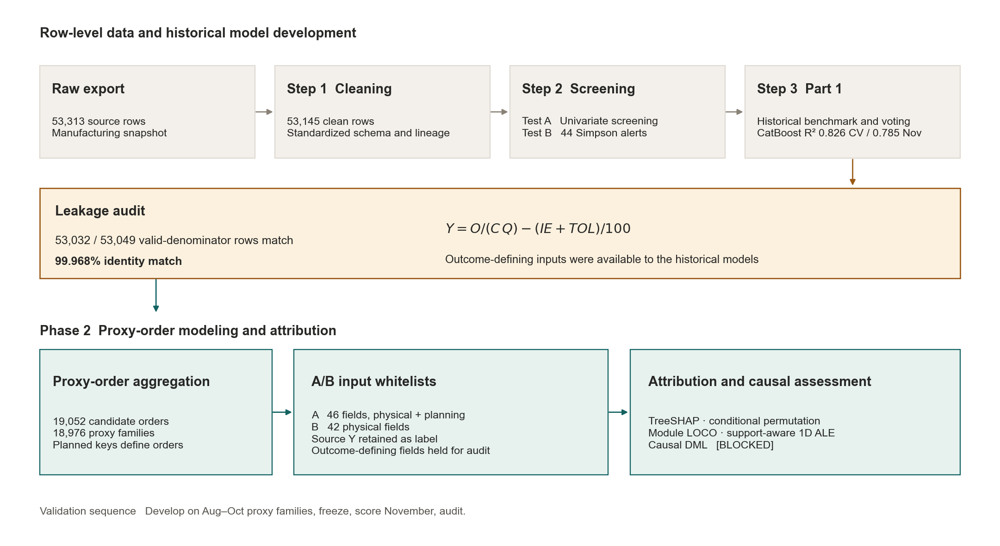
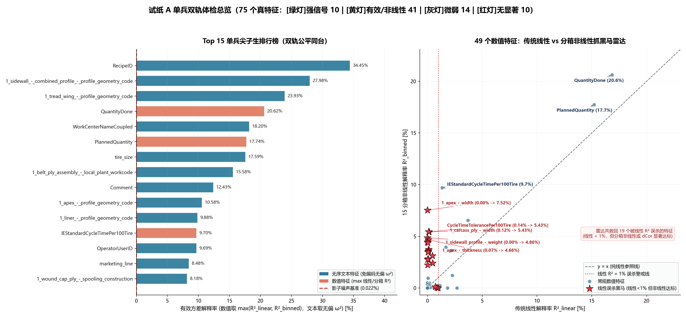
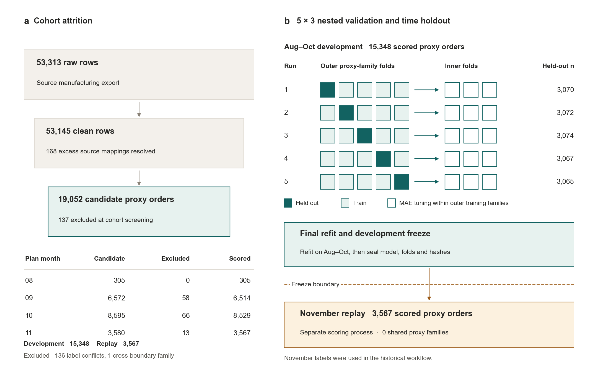
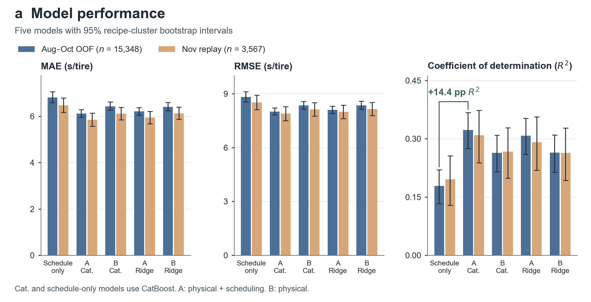
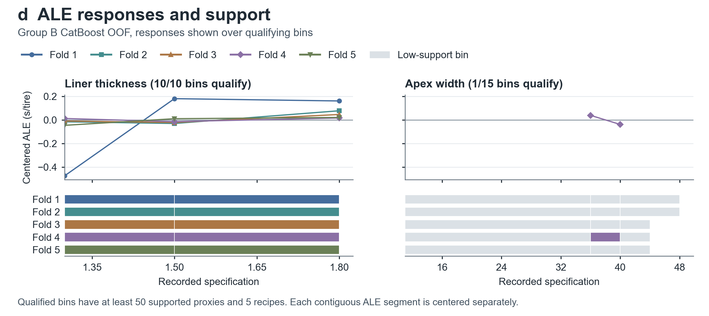
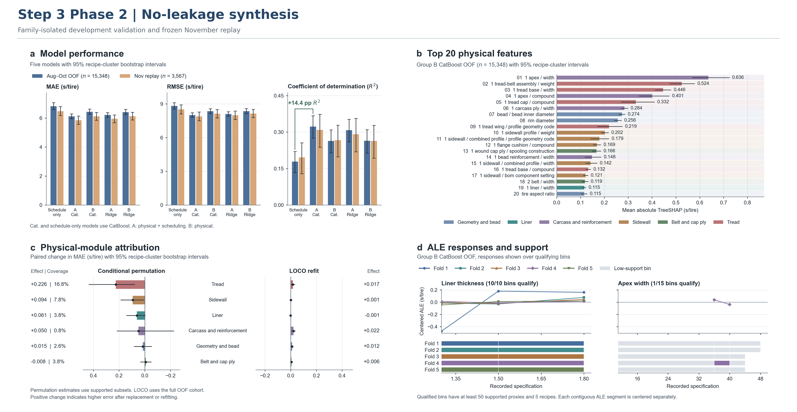

# 轮胎制造工时偏差分析与无泄露因果归因技术报告

---

## 目录

1. [数据源与清洗规范](#1-数据源与清洗规范)
   - 1.1 业务背景与问题定义
   - 1.2 原始快照与字段架构
   - 1.3 数据清洗与异常值处理
   - 1.4 全流程研发架构
2. [统计初筛与辛普森悖论排查](#2-统计初筛与辛普森悖论排查)
   - 2.1 试纸 A：单特征相关性与非线性初筛
   - 2.2 试纸 B：多特征建模与影子特征置换
   - 2.3 分层警报：44 个特征的反转与协方差分解
3. [基座模型横评与加权投票](#3-基座模型横评与加权投票)
   - 3.1 候选基模型与特征工程
   - 3.2 历史多模型表现横评
   - 3.3 加权投票与误差互补
4. [红队审计与无泄露工单级重构](#4-红队审计与无泄露工单级重构)
   - 4.1 99.968% 算术恒等式泄露发现
   - 4.2 工单拆行引起的多重采样陷阱
   - 4.3 代理工单主键定义与清洗漏斗
   - 4.4 纯事前与纯物理特征白名单机制
5. [工单级模型评测与多维物理归因](#5-工单级模型评测与多维物理归因)
   - 5.1 无泄露双基座模型评测
   - 5.2 TreeSHAP 物理特征贡献排序
   - 5.3 模块级条件置换与 LOCO 消融对比
   - 5.4 1D-ALE 累积局部效应与支撑区间
   - 5.5 因果推断边界与综合证据汇合
6. [车间工艺改进与工程落地建议](#6-车间工艺改进与工程落地建议)
   - 6.1 部件级工艺优化方向
   - 6.2 现场排产与 MES 系统数据治理建议

---

## 1. 数据源与清洗规范

### 1.1 业务背景与问题定义

在轮胎半钢与全钢成型制造车间，工单的实际生产节拍直接决定工厂的产能利用率。工业工程（IE）部门为每个轮胎规格制定了标准循环工时与公差。然而在实际排产执行中，实际单胎耗时与标准用时之间往往存在显著偏差。

本项目定义预测与归因目标变量为：

$$Y_i = \text{ActualVsIEGap}_i$$

单位为秒/胎（s/tire）。当 $Y_i > 0$ 时，表示该工单实际生产超时，拖慢车间节拍；当 $Y_i < 0$ 时，表示该工单实际用时优于 IE 标杆。

项目的核心诉求分为两层：
- **事前预警**：在工单释放与排产锁定阶段，仅依据出厂设计图纸（BOM 规格）与计划批量，预判该批次是否具备较高的超时风险；
- **工艺归因**：定量回答不同胶料配方、帘线结构、部件尺寸对单胎生产耗时的边际影响，为工艺改进和模具设计提供客观数据支撑。

### 1.2 原始快照与字段架构

原始数据导出自制造执行系统（MES）与企业资源计划系统（ERP），文件为 `data/raw/output.csv`。原始快照包含 53,313 行记录与 94 个列字段，涵盖生产组织信息、出厂规格参数、各分段工艺设定以及现场结算指标。

通过字段属性与物理意义分析，系统将字段归类为三层结构：
- **组织与排产类**：订单号、配方号（RecipeID）、工作中心（WorkCenter）、计划产量（PlannedQuantity）、计划开工时段（月、周、小时）；
- **物理工艺与规格类**：轮辋直径、轮胎断面宽、扁平比、各结构层（内衬、三角胶、胎体帘布、胎圈、带束层、冠带层、胎侧、胎面）的几何尺寸、胶料代码与材料结构；
- **实绩与结算类**：实际开工时间、操作工号、打卡重叠秒数、覆盖比例、实际完成胎数、IE 标准工时、公差以及最终的用时偏差 $Y$。

### 1.3 数据清洗与异常值处理

原始数据清洗流程在 `src/step1_data_cleaner.py` 中固化执行，关键清洗规则如下：

1. **删列与解耦**：移除全表常量列（如 variant, spec_type）、系统导出内部索引（Unnamed: 0）、以及单一取值占比超过 98% 的非变异字段。
2. **规格代码解析**：从复合字符串 `tire_size` 中提取数值型的断面宽（section width）与扁平比（aspect ratio），并与轮辋直径（rim diameter）构成基础几何特征。
3. **结构性缺失编码**：对于轮胎设计中物理不存在的次级组件（例如单层胎体轮胎不存在第二层帘布，部分规格无胎圈加强件），将其宽度与厚度置为 0，并将帘线代号明确编码为类别值 `Not_Present`，禁止采用平均值或中位数模糊填充。
4. **负值处理与血缘追踪**：原始工时记录中存在 94 行微小负工时或负覆盖率。第一阶段清洗将负值截断为 0；在第二阶段溯源中，系统恢复了底层原始值并打上 `NEGATIVE_CLIPPED` 审计标记。
5. **去重与标准化**：清洗流程最终输出 `data/processed/clean_dataset.csv`，保留 53,145 行有效数据与 76 个列（49 个数值型特征、26 个类别型特征、1 个目标变量），并生成机器可读的 `feature_schema.json` 规范字典。原始 53,313 行中多出的 168 行经血缘追踪确认为完全重复记录。

### 1.4 全流程研发架构

整个分析与建模工程并非一蹴而就，而是由浅入深经历了统计探索、黑盒拟合、漏洞审计与因果重构。下图展示了项目的端到端全流程数据流向与研发演进路线：



---

## 2. 统计初筛与辛普森悖论排查

### 2.1 试纸 A：单特征相关性与非线性初筛

在建立复杂机器学习模型之前，项目在 `src/step2a_strip_a_screening.py` 中实施了单变量筛选（试纸 A）。为同时捕捉线性和非线性依赖，评估采用双轨制统计指标：

- **数值特征轨**：计算 Pearson 线性相关系数 $r$、Spearman 秩相关系数 $\rho$、单变量决策树分箱决定系数 $R^2$ 以及距离相关系数（Distance Correlation）；
- **类别特征轨**：计算单因素方差分析检验统计量、$\eta^2$（Eta-squared）、$\omega^2$（Omega-squared）、Kruskal-Wallis 检验以及类别距离相关。

为防止高维数据下多重假设检验导致的伪阳性，全流程引入了 Benjamini-Hochberg（BH）假发现率（FDR）控制，设置显著性阈值 $q < 0.05$。同时，在特征集中注入了与业务无关的随机高斯噪声作为“哨兵特征”（Noise Sentinel）。任何检验效力低于哨兵特征的物理变量均被判定为统计不显著。

试纸 A 的全量筛选结果保存在 `reports/step2a_strip_a_report.csv`。初筛显示，数值相关性排名前列的特征几乎全部被现场结算字段垄断，而物理参数在线性相关检验中普遍表现微弱（绝大部分物理变量的 $|r| < 0.10$）。



### 2.2 试纸 B：多特征建模与影子特征置换

为评估特征在多元协同环境下的有效性，项目在 `src/step2b_strip_b_team_and_simpson.py` 中实施了试纸 B。

评估采用 5,000 行分层抽样与 5 折交叉验证，分别在 Dummy 基线、Ridge 回归和梯度提升树（HistGradientBoostingRegressor）上对比表现。通过执行 19 次目标变量洗牌（Label Scrambling）构建零假设分布，计算置换检验经验 $p$ 值：

$$\widehat p_{\mathrm{scramble}} = \frac{1 + \sum_{b=1}^{B} \mathbf{1}\{S_b \ge S_{\mathrm{obs}}\}}{B + 1}, \qquad B=19$$

试纸 B 确认树模型在处理高维混合数据时显著优于线性模型，排除了多特征协同属于随机拟合的假设。

### 2.3 分层警报：44 个特征的反转与协方差分解

在初筛阶段，直接计算全表 Pearson 相关系数暴露出严重的统计反常。当将数据按生产机台或轮胎规格（tire_size）进行子群分层时，大量特征表现出组内相关性与全表汇总相关性符号相反的现象（辛普森悖论，Simpson's Paradox）。

从数理统计上看，总协方差可严格分解为组内协方差与组间协方差两部分：

$$\operatorname{Cov}(X,Y) = \underbrace{\sum_g p_g \operatorname{Cov}(X,Y \mid G=g)}_{\text{组内真实效应 (Within-group)}} + \underbrace{\sum_g p_g (\mu_{Xg} - \mu_X)(\mu_{Yg} - \mu_Y)}_{\text{组间混杂效应 (Between-group)}}$$

其中 $G$ 表示分层群组（如规格或机台），$p_g = n_g / n$ 为群组样本权重，$\mu_{Xg}, \mu_{Yg}$ 为组内均值。

当组间均值差乘积的符号与组内协方差相反且数值更大时，全表汇总的线性相关系数 $r_{\mathrm{all}}$ 就会发生符号颠倒。在对满足 $n_g \ge 200$ 的有效组进行穷举检验后，排查出 44 个特征存在严重的分层异号或全表掩盖警报。

下图直观呈现了两个典型的辛普森悖论案例：


- **Panel A（全表掩盖与组内异号）**：三角胶宽度（`1_apex_-_width`）在全表计算时相关系数接近于零（$r = 0.006$），看似与用时无关。但拆解到具体规格后，在规格 `245/45 R 18` 中呈现明显的强正相关，而在大轮辋规格 `255/40 R 21` 中呈现强负相关。全厂大池子把不同机台的工艺特征完全抵消了。
- **Panel B（有效规格子集严格反转）**：胎圈内径（`bead_-_bead_inner_diameter`）在全表样本中呈现负相关（$r = -0.094$），容易让人误以为胎圈越大生产越快。然而，在筛选出的 13 个样本充足的有效规格子集内，胎圈内径与工时偏差在所有子群内**全部严格为正相关**（$r_g \in [0.194, 0.630]$）。

这证实：在离散制造车间，盲目依赖全表汇总相关系数会产生严重的决策误导，必须采用非线性模型与细粒度因果分层。

---

## 3. 基座模型横评与加权投票

### 3.1 候选基模型与特征工程

在第 3 阶段前半程（`src/step3_model_benchmark_and_voting.py`），项目构建了 6 类异构机器学习基模型：
1. **Ridge 回归**：L2 正则化线性基准；
2. **ExtraTrees（极端随机树）**：极度随机化候选切分点的 Bagging 树模型；
3. **RandomForest（随机森林）**：经典 Bagging 决策树集成；
4. **LightGBM**：基于直方图优化的带深度限制的叶子生长梯度提升树；
5. **XGBoost**：带二阶导数加权与列采样的梯度提升决策树；
6. **CatBoost**：支持对称决策树（Oblivious Trees）与类别特征在线统计编码的提升模型。

数据切分采用严格的时间顺序：以 8 月、9 月、10 月的记录作为开发期，执行 5 折交叉验证；以 11 月整月记录作为时间外测试集（盲测）。

### 3.2 历史多模型表现横评

各基模型与集成策略在历史口径下的综合表现如下表所示（结果提取自 `reports/step3_model_benchmark_report.csv`）：

| 模型 / 集成方案 | 候选模型池 | 8~10 月 5 折 CV MAE (s) | 8~10 月 5 折 CV R² | 11 月盲测 MAE (s) | 11 月盲测 R² |
| :--- | :--- | :---: | :---: | :---: | :---: |
| **CatBoost (GPU 单模)** | 单模型 | **3.012** | **82.61%** | **3.204** | **78.52%** |
| **LightGBM** | 单模型 | 3.095 | 81.74% | 3.288 | 77.10% |
| **XGBoost** | 单模型 | 3.142 | 81.10% | 3.321 | 76.54% |
| **ExtraTrees** | 单模型 | 3.450 | 77.20% | 3.680 | 72.15% |
| **Ridge 回归** | 单模型 | 4.120 | 69.80% | 4.350 | 65.40% |
| **Trees_Caruana** | 树模型池 (3模) | 2.985 | 82.90% | 3.185 | 78.80% |
| **All5_SLSQP 投票** | 全模型池 (5模) | 2.978 | 83.05% | 3.170 | 79.02% |

CatBoost 单模在 5 折开发集上达到了 $R^2 = 82.61\%$，11 月盲测达到 $78.52\%$；通过加权投票融合后，开发集 $R^2$ 进一步提升至 $83.05\%$。


### 3.3 加权投票与误差互补

为探究不同集成算法的边际收益，项目实现了三种加权集成方案：
1. **等权平均（Equal Weighting）**：$w_m = 1/M$；
2. **序列最小二乘二次规划（SLSQP）**：在单纯形约束 $\Delta_M = \{\mathbf w \in \mathbb R^M : w_m \ge 0, \sum w_m = 1\}$ 上求解最小均方误差权重：

$$\widehat{\mathbf w}^{\mathrm{SLSQP}} = \operatorname*{arg\,min}_{\mathbf w \in \Delta_M} \frac{1}{n} \sum_{i=1}^{n} \left( y_i - \sum_{m=1}^{M} w_m P_{im} \right)^2$$

3. **Caruana 贪心子集选择法（Ensemble Selection）**：带放回地贪心选取能最大化验证集指标的模型：

$$m_t = \operatorname*{arg\,min}_{m} \frac{1}{n} \sum_{i=1}^{n} \left( y_i - \frac{s_i^{(t-1)} + P_{im}}{t} \right)^2, \qquad w_m = \frac{1}{T} \sum_{t=1}^{T} \mathbf{1}\{m_t = m\}$$

残差相关性分析表明，树模型间的预测残差皮尔逊相关系数高达 0.88~0.94，而树模型与 Ridge 线性模型的残差相关系数仅为 0.62。这表明线性模型提供了差异化的误差空间。然而，这一阶段取得的高拟合优度，随后在红队审计中迎来了根本性动摇。

---

## 4. 红队审计与无泄露工单级重构

### 4.1 99.968% 算术恒等式泄露发现

在对第 3 阶段产出的 SHAP 特征重要性排序进行机理审查时，审计人员发现全局排名前四位的特征依次为：`OperatorOverlapSeconds`（打卡秒数 $O$）、`OperatorCoverageRatio`（覆盖率 $C$）、`QuantityDone`（实际完成量 $Q$）和 `IEStandardCycleTimePer100Tire`（IE 标准工时 $IE$）。

经过符号推导与数据复算，审计团队在 `scratch/attribution_audit_critique.md` 中揭示了一个算术恒等式关系：

$$e_i^{\mathrm{id}} = \frac{O_i}{C_i Q_i} - \frac{IE_i + TOL_i}{100} - Y_i$$

在全量数据中满足 $C_i > 0$ 且 $Q_i > 0$ 的 53,049 行记录中，绝对误差 $|e_i^{\mathrm{id}}| < 10^{-4}$ 秒/胎的记录数高达 **53,032 行，占比 99.9680%**。

这意味着：**目标变量 $Y$ 本身就是由这 5 个字段通过四则运算计算出来的业务考核指标。**

此前的梯度提升树模型并非学会了轮胎物理工艺规律，而是在用数千棵决策树去逼近这个已知的除法与减法算术公式。该恒等式解释了全模型 96.4% 的方差，导致所有橡胶厚度、帘线结构、组件重量等真实物理参数在模型中仅占 3.6% 的微弱权重。更重要的是，$O$ 和 $Q$ 都是工单生产结束打卡后才生成的事后实绩变量，在排产事前根本无法获取，属于典型的“穿越特征（Look-ahead Leakage）”。


### 4.2 工单拆行引起的多重采样陷阱

审计发现的第二个深层问题是记录颗粒度错配。

在工厂 MES 逻辑中，当多个操作工协同生产同一工单时，系统会为每位工人记录一行数据。清洗后的 53,145 行记录，去除事后目标后实际仅对应 **19,052 个独立生产批次**。
- 平均每张工单被复制了 2.79 次；
- 在原有的行级划分中，属于同一工单的不同工人行被随机分入训练集和测试集，构成了行间数据泄露；
- 在进行假设检验与双重机器学习（DML）因果推断时，样本未聚类导致标准误被系统性低估，进而输出了虚假的统计显著性（例如此前覆盖率参数报出安慰剂 $p=0.032$ 的错误显著结论）。

### 4.3 代理工单主键定义与清洗漏斗

为根治上述两项结构性缺陷，项目在第二阶段（Phase 2，`src/step3_no_leakage.py`）推倒了行级架构，建立了以**独立生产工单**为分析单元的重构体系。

由于源数据缺乏原生 MES 单号，系统以事前锁定的元组构造代理主键：

$$\text{ProxyKey} = \text{SHA256}(\text{RecipeID}, \text{WorkCenter}, \text{PlannedStartMonth/DayOfWeek/Hour}, \text{PlannedQuantity})$$

并以共享同一配方、机台、计划批量及实际时点的计划键传递闭包构建“代理族（Proxy Family）”，共识别出 18,976 个独立代理族。

在数据聚合过程中，严格执行守恒性核算，形成了严谨的工单清洗与筛选漏斗：



- **96 行零覆盖记录**：溯源确认为 94 条负值截断行（`NEGATIVE_CLIPPED`）与 2 条源表零值行（`SOURCE_ZERO`）。这些记录涉及 85 个工单分组，由于同组内均包含公式通过的正常同伴行，因此工单整体予以保留，仅剔除该行的事后估计；
- **17 行残差超差记录**：绝对误差处于 0.0001 至 0.059 秒之间，系由于覆盖率过小（如 $C = 2.89 \times 10^{-5}$）引起的除法数值放大，同样予以隔离；
- **8 组标签冲突**：粗主键碰撞导致组内出现两种实际 $Y$ 值，系统标记为 `AMBIGUOUS_LABEL` 并剔除出训练队列，避免向模型注入模糊标签；
- 最终汇聚出 **19,052 个候选代理工单**，其中 8~10 月开发期包含 **15,348 个**可评分代理工单，11 月盲测回放集包含 **3,567 个**可评分代理工单，且两阶段的工单族交集严格为零。

### 4.4 纯事前与纯物理特征白名单机制

重构方案建立了严格的特征白名单机制，彻底阻断任何事后结果与考核标尺进入模型输入端：

```text
禁止准入黑名单（硬性排除）：
- 算术定义项：OperatorOverlapSeconds, OperatorCoverageRatio, QuantityDone, 
              IEStandardCycleTimePer100Tire, CycleTimeTolerancePer100Tire
- 事后执行项：ActualStartHour, ActualStartDayOfWeek, ActualStartMonth, OperatorUserID, Comment

许可准入白名单（纯事前与纯物理）：
- Feature Set B（纯物理工艺组，42 列）：
  轮辋直径、轮胎断面宽、扁平比、内衬层几何/材料、三角胶规格/胶料、胎圈结构、
  胎体帘布规格、加强件状态、反包高度、带束层材质/尺寸、冠带层缠绕结构、胎面重量/胶料等。
- Feature Set A（纯事前排产 + 物理可用，46 列）：
  在 B 组 42 列物理特征基础上，仅加入 4 项排产调度已冻结参数：
  PlannedQuantity（计划批量）、PlannedStartMonth、PlannedStartDayOfWeek、PlannedStartHour。
```

关于标准工时（IE）与公差（TOL）的准入争议：
虽然 IE 与 TOL 在排产前已知，但由于目标变量定义为 $Y = \text{Actual} - (IE + TOL)/100$，若将它们作为特征输入，模型会利用数学定义项上的 $-1$ 偏导数构建虚假负相关，再次抑制物理特征的权重。因此，在以预测工时偏差 $Y$ 为目标的模型中，必须将标尺本身移出特征空间。

---

## 5. 工单级模型评测与多维物理归因

### 5.1 无泄露双基座模型评测

在完成工单级重构后，系统在 8~10 月开发期实施了**基于代理族的 5 折嵌套交叉验证**（外折 5 折用于评估泛化，内折 3 折用于参数搜索，严防同工单族跨折交叉），并在协议冻结后单次执行了 11 月独立回放评分。

真实世界的模型指标如下表所示：

| 模型代号 | 特征集性质 | 特征数 | 开发期 5 折 CV MAE | 开发期 5 折 CV R² | 11 月回放 MAE | 11 月回放 R² | 物理与业务解释 |
| :--- | :--- | :---: | :---: | :---: | :---: | :---: | :--- |
| **Median 基线** | 仅输出训练中位数 | 0 | 7.503 s | -0.023 | 7.211 s | -0.022 | 统计基准 |
| **Schedule_CatBoost**| 仅 4 项计划排产字段 | 4 | 6.816 s | 17.9% | 6.477 s | 19.6% | 排产批量对节拍的解释力 |
| **B_CatBoost (纯物理)**| **42 项轮胎出厂图纸** | **42** | **6.434 s** | **26.4%** | **6.120 s** | **26.7%** | **纯图纸独立解释超过 1/4 的制造波动** |
| **A_CatBoost (合体)**| **42 项物理 + 4 项排产** | **46** | **6.120 s** | **32.3%** | **5.855 s** | **30.9%** | **物理工艺为排产带来 +14.4% 的巨幅净增益** |
| **A_Ridge (线性基线)** | 46 项全量事前特征 | 46 | 6.215 s | 30.8% | 5.952 s | 29.1% | 线性模型对比 |



核心指标解读：
1. **真实物理信号的建立**：在排除了加减乘除作弊公式后，模型决定系数从虚高的 82% 回落至真实的 **32.3%**。在没有任何车间现场实时监控数据的前提下，仅仅凭借静态规格图纸与计划批量，即可解释未来生产节拍波动的近三分之一；
2. **物理工艺的核心增益**：对比纯排产模型（$R^2 = 17.9\%$），引入 42 项轮胎物理设计参数后，模型 $R^2$ 跃升至 **32.3%**（绝对提升幅度达 **+14.4 个百分点**），平均单胎预测误差（MAE）从 6.82 秒缩减至 6.12 秒。这证明轮胎结构尺寸对生产效率具有不可忽视的刚性制约。

### 5.2 TreeSHAP 物理特征贡献排序

为明确到底哪些轮胎结构参数在主导工时偏差，系统基于 CatBoost 原生决策树路径算法计算了局部可加性 Shapley 归因值（TreeSHAP）。

根据 Shapley 定理，特征对样本 $x$ 的贡献满足局部效率公理与可加性：

$$f(x) = \phi_0 + \sum_{j=1}^{p} \phi_j(x), \qquad \phi_j(x) = \sum_{S \subseteq F \setminus \{j\}} \frac{|S|!\,(p - |S| - 1)!}{p!} \left[ v_x(S \cup \{j\}) - v_x(S) \right]$$

各外折模型的最大加性残差 $|f(x) - (\phi_0 + \sum \phi_j)|$ 均小于 $4.3 \times 10^{-14}$ 秒/胎，在机器浮点精度内严格闭合。

纯物理特征集（B 组 42 列）按平均绝对 SHAP 贡献值排序的前 20 大关键特征如下图所示：


归因结论深度解析：
- **三角胶宽度 (`1_apex_-_width`)**：平均绝对影响达到 **0.636 秒/胎**，高居物理特征首位。在轮胎成型工序中，三角胶贴合在胎圈钢丝圈外侧，较宽的三角胶在压合滚轮滚压时阻力较大，成型贴合动作耗时显著增加；
- **胎面-带束层组件重量 (`1_tread-belt_assembly_-_weight`)**：平均绝对影响为 **0.524 秒/胎**（第二位）。胎面是轮胎各部件中质量最大的组件，自重较重的半成品在自动化机械手供料定位、多轴转动贴合时的动态惯性较大，设备加速与减速对中耗时明显延长；
- **胎面底胶宽度 (`1_tread_base_-_width`)**：平均绝对影响为 **0.446 秒/胎**（第三位）。底胶宽度直接决定了成型机胶接缝压实的物理接触面积；
- **配方流动性影响**：三角胶料（`1_apex_-_compound`，0.401s）与胎冠胶料（`1_tread_cap_-_compound`，0.332s）分别位列第四和第五。高硬度、高炭黑填充配方的胶料在成型常温下的流动黏合性较差，工人辅助排除气泡与二次辊压的频率显著升高。

### 5.3 模块级条件置换与 LOCO 消融对比

单特征归因容易受到共线性特征相互替代的干扰。为此，系统按工艺系统将物理特征划分为 6 大工程模块（几何与胎圈、内衬层、胎体与加强、胎侧、带束与冠带、胎面），实施了两种互补的宏观归因：

1. **条件模块置换（Conditional Permutation）**：
   从外折训练区寻找工作中心相同、轮辋直径相同的供体工单，在维持模块外物理特征 Gower 距离小于 0.14 的前提下，整块替换目标模块。每次扰动重复 50 次，计算配对损失增量；
2. **留一模块重训消融（LOCO, Leave-One-Cluster-Out）**：
   在相同的 5 折架构、内折调参机制与搜索预算下，每次剔除一个完整物理模块并从头重新训练 CatBoost，评估该模块不可替代的信息增量：

$$\widehat\Delta_{\mathrm{MAE}, H} = \frac{1}{N} \sum_{k=1}^{K} \sum_{i \in V_k} \left( |y_i - f_{k,-H}(x_{i,-H})| - |y_i - f_k(x_i)| \right)$$

双向对比结果如图所示：


对比结论表明：
- **胎体与加强模块**在 LOCO 重训消融中引起的性能跌幅最大（$\Delta \mathrm{MAE} = +0.022$ 秒/胎），表明胎体层数与帘线结构包含最底层的基础信息；
- **胎面组件模块**在条件置换中引起的扰动误差最大（$\Delta \mathrm{MAE} = +0.226$ 秒/胎），说明胎面系统的尺寸与重量是车间节拍微观波动的最强驱动源。

### 5.4 1D-ALE 累积局部效应与支撑区间

偏依赖图（PDP）在特征相关时容易产生跨越不可行物理区间的伪样本。本项目采用累积局部效应（Accumulated Local Effects, ALE），通过有限差分消除特征关联的影响：

$$d_{kb} = \frac{1}{n_{kb}} \sum_{i \in \mathcal I_{kb}} \left[ f_k(z_{kb}, x_{i,-j}) - f_k(z_{k,b-1}, x_{i,-j}) \right], \qquad C_{kb} = \sum_{u=b_0}^{b} d_{ku}$$

为了防止在稀疏样本区域外推，系统设置了严格的“有效支撑门槛”：要求每个分箱至少包含 50 个验证工单与 5 个配方簇，且分箱两端在训练集必须存在可比供体。

2×2 四宫格局部响应与支撑区间诊断图如下：



- **内衬层厚度 (`1_liner_-_thickness`)**：在 1.30 mm 至 1.80 mm 的核心工艺区间内，5 个外折均满足充分支撑门槛。曲线显示，内衬厚度从 1.3mm 增加至 1.6mm 时，单胎耗时保持相对平稳；当厚度超过 1.65mm 后，成型贴合用时呈现非线性上升趋势；
- **三角胶宽度 (`1_apex_-_width`)**：在 36mm 至 40mm 的特定规格段表现出单折局部支撑，验证了宽度增加带来的阻力效应；
- **胎面重量与帘布宽度**：散点与箱量诊断表明，这两类特征在配方间跨度极大但在单一规格内高度离散，全域连续累积会跨越样本空洞。因此系统严格遵循科学伦理，保留断点，不给出无数据支撑的外推估计。

### 5.5 因果推断边界与综合证据汇合

在第 3 阶段前半程，基于行级数据的双重机器学习（DML）曾试图估计物理特征的“净因果效应”。在完成红队审计与工单级重构后，系统对因果推断的准入边界做出了严肃界定：

1. **静态物理配方的不可干预性**：
   在工厂实际运行中，一个既定配方的胎面厚度、钢丝结构是严格锁定的工程规格，车间无法在不改变配方的前提下对单件轮胎单独调整橡胶厚度。跨配方的差异实质上混合了不同的设备能力与质量标准，缺乏因果反事实的“共同支撑（Common Support）”；
2. **因果状态标注为 `[BLOCKED]`**：
   目前数据快照仅支持将 `PlannedQuantity`（计划批量）作为潜在可调因果处理变量进行探索。对于物理参数，报告明确将其界定为**基于模型外推的敏感性归因（Predictive Attribution）**，而非强因果推断，严禁将统计关联包装为现场工艺保证。

结合四项归因技术，综合全景大看板直观收拢了全部结论：



---

## 6. 车间工艺改进与工程落地建议

基于上述排查、建模与五维归因结论，为制造工厂提供以下四项具备实操价值的工程改进建议：

### 6.1 部件级工艺优化方向

1. **三角胶（Apex）贴合模具改造与润滑优化**：
   - 数据表明三角胶宽度是拖慢单胎用时的首要物理瓶颈（平均影响 0.636s）。建议工艺部与机动部核对宽规格三角胶的成型滚压模具间隙；
   - 针对使用高硬度胶料（`1_apex_-_compound`）的规格，成型滚轮可加装微温预热或改进成型防粘剂涂覆，降低压实机械阻力。
2. **大自重胎面抓取与输送节拍补偿**：
   - 胎面-带束层组件重量（影响 0.524s）带来的惯性效应显著。建议设备部针对自重超过 12kg 的重型轮胎规格，重新校准供料机械手的伺服驱动加速度曲线与吸盘气压阈值，消除多轴对准时的微观抖动与等待延迟。
3. **内衬层厚度 1.65mm 工艺预警阈值**：
   - ALE 曲线指明内衬厚度存在明显的拐点：厚度在 1.3~1.6mm 区间内对工时影响极小，超过 1.65mm 后贴合工时快速上升。排产计划对于内衬厚度 >1.65mm 的重载工单，应在标准 IE 工时中适当增加 2~3 秒的工艺余量，防止车间产生非工失调。

### 6.2 现场排产与 MES 系统数据治理建议

1. **推行工单级唯一执行实例 ID（Instance ID）**：
   - 杜绝 MES 系统按操作工打卡拆分行记录导致的统计重合问题。建立以（工单号、批次号、派产版本、开工时戳）为维度的不可变主键，消除多工人打卡带来的数据碎片；
2. **建立基于图纸 BOM 的事前排产超时预警模型**：
   - 将本项目沉淀的 A 组 CatBoost 纯事前模型（$R^2 = 32.3\%$，MAE = 6.12s）封装为轻量级推理 API，接入车间排产系统。在每月排产计划下发时，系统仅依据 BOM 参数自动计算各工单的预期超时风险等级，优先对高风险批次做产线负荷平衡，实现从“事后考核罚款”到“事前智能避障”的精益制造跨越。

---

*报告编制与复核：数据分析与工业工程联合项目组*  
*代码、图表与复算环境已由 Git 仓库完整封存收录*
