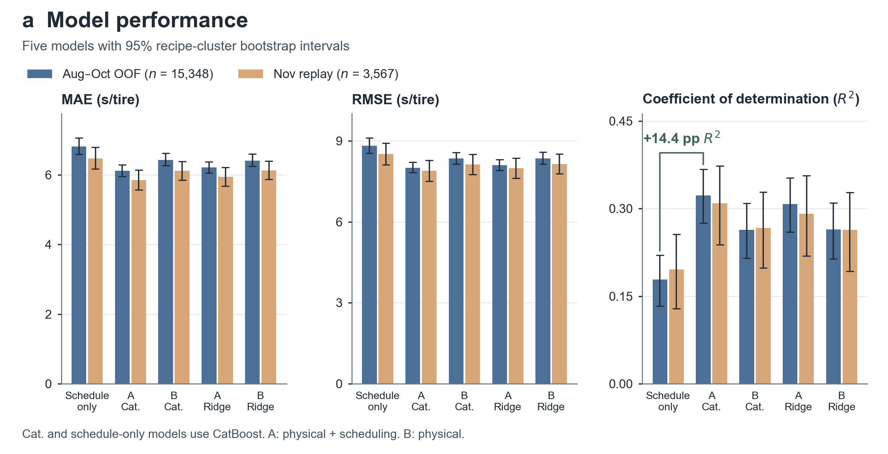
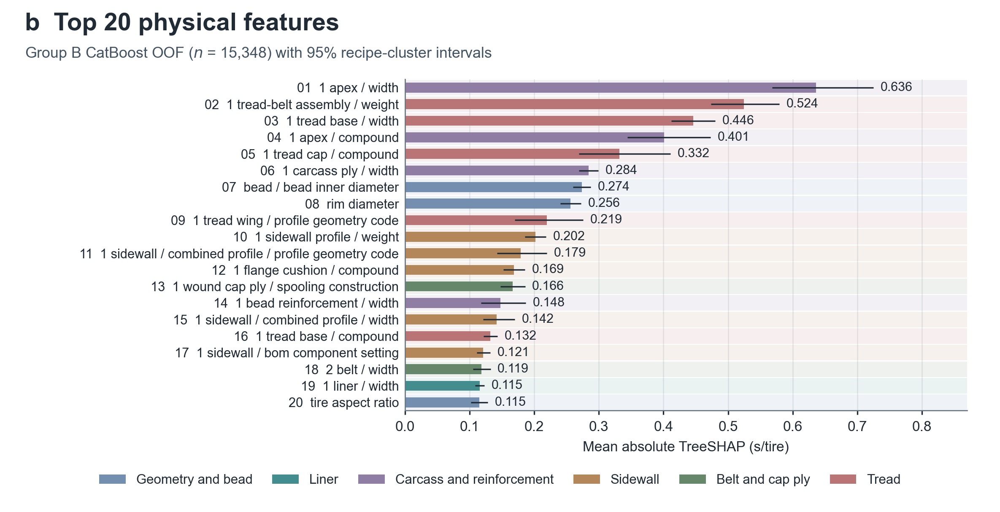
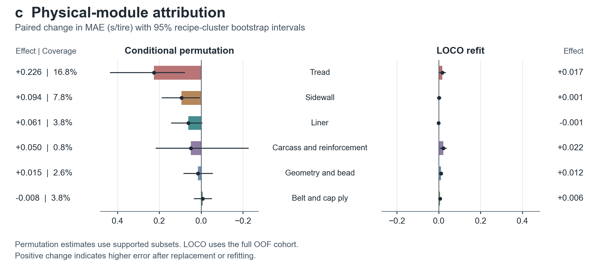
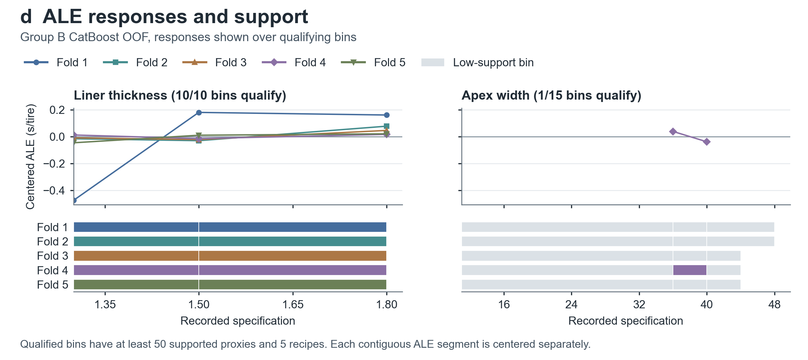

# 无泄露工单级重构与真实物理归因报告

## 1. 结论与适用范围

[PASS] 按审定白名单完成 CSV 快照级特征净化、代理工单聚合、开发期嵌套交叉验证、11 月冻结回放和四项预测归因。全量保留 **19,052** 个候选组、**15,348** 个开发期可评分代理单和 **3,567** 个 11 月可评分代理单。标签为源表 `ActualVsIEGap`，误差单位为秒/胎。每个可评分代理单权重相同。

11 月回放中，A 组 CatBoost 的 MAE 比 B 组低 **0.265** 秒/胎。条件置换覆盖最高 **16.8%**，六个模块均只达到子群发布条件。内衬厚度的 ALE 在五折有支撑，响应方向和幅度随折变化。

[BLOCKED] MES 原生执行 ID、父单谱系、实际排产发布时间、PLM/BOM 历史版本、闭单可见时间和独立设备循环事件均未包含在两份 CSV。生产工单唯一性、真实工单族隔离、t0 时点一致性、开发期滚动验证、独立评分及生产发布依赖这些材料。以下结果反映该快照上的代理工单回放和预测归因。旧流程使用过 11 月标签，历史首轮盲测资格无法恢复。本次依次执行开发冻结和独立评分进程，进程由同一分析方运行。

## 2. 身份、血缘与异常裁定

- 代理主键为配方、现有工作中心、计划月/星期/小时和计划批量，按类型化元组计算 SHA-256。工作中心的计划属性尚待确认，仅参与对账和相容条件。实际起点只参与代理族连边、跨边界隔离和审计。代理族是共享同一配方、工作中心、计划批量和实际月/星期/小时的计划键传递闭包，共 18,976 族。它只能隔离可观察的重复或修订候选。
- 原始导出 53,313 行全部映射到 53,145 条清洗记录，余下 168 条是多条源行映射到同一清洗记录的血缘差额。按导出顺序定位原始行和清洗行。原值、源文件校验值、来源序号和转换后的状态全部可追溯。
- **19,181** 为含实际起点、完成量的历史分组数，专用于旧口径对账。该口径有 8 组、38 行的 Y 冲突。候选计划键口径实际隔离 136 个 Y 冲突组，对该键下的重复记录要求结算四项一致。全体清洗行 Q 合计 8,211,500，历史分组各计一次 Q 为 2,817,787，供现场核对重复量。
- 96 条零覆盖记录溯源为 94 条 `NEGATIVE_CLIPPED` 和 2 条 `SOURCE_ZERO`。17 条 `IDENTITY_RESIDUAL` 的绝对残差至少为 0.0001 秒/胎，两类合计涉及 98 个历史分组。公式对账按 `O/(C×Q) − (IE+TOL)/100 − Y` 计算。异常行保留原始标签及残差，运行秒数代理留空。该组有通过公式的同伴且结算一致时，允许进入快照回放。待 MES 按执行与闭单版本裁定。
- 计划月与实际月不同的源记录有 8 行。代理族或该组计划与实际落在开发/回放不同侧的候选共 1 个，评分集合间的代理族交集为 0。下表每组只记一个主要隔离原因，完整冲突标志见审计表。覆盖率分母为快照中该计划月所有候选键。

| 计划月 | 清洗记录 | 候选组 | 可评分 | 覆盖率 | 隔离原因 |
| --- | --- | --- | --- | --- | --- |
| 8 | 340 | 305 | 305 | 100.00% | 0 |
| 9 | 17,056 | 6,572 | 6,514 | 99.12% | 标签有冲突 58 |
| 10 | 26,052 | 8,595 | 8,529 | 99.23% | 标签有冲突 66 |
| 11 | 9,697 | 3,580 | 3,567 | 99.64% | 标签有冲突 12，代理族跨边界 1 |

## 3. 字段与验证协议

- B 含 42 个登记的物理设计与工艺字段，A 含 B 和 4 项计划字段。O、C、Q、IE、TOL、Y、实际时间与人员等事后字段全部隔离。配方、机台、工装、PTC 和胶囊代码留在模型输入之外。试验使用现有清洗快照，继承上游全表删列与去重口径。入模列由方案固定，折内词表和数值转换由模型训练分区估计。
- 数字形态的胶料代号、反包结构、胎圈和冠带构造按名义属性处理。胎圈 5x6 与 6x5 的原结构单列保留在原始血缘。胎侧 BOM 数值按快照规格保留，单位待工程确认。二层帘布与加强件的结构性缺件保留同步编码。
- 开发期使用按计划月平衡的 5 个代理族外折，每个外折内用 3 个代理族折按 MAE 选参。CatBoost 从两套预设迭代数和深度中选择，固定迭代并关闭早停。Ridge 折内进行中位数插补、数值缩放、名义独热编码和正则调参。基准为折训练中位数与均值。A、B、排产单独、A 去计划月和 LOCO 共享外折与评价标签。
- 开发冻结（UTC）`2026-11-20T05:39:10.117804+00:00`。11 月批量评分封存（UTC）`2026-11-20T05:39:33.189787+00:00`。冻结清单记录源、代码、模型、阈值、折成员与产物校验值。评分封存后，原始血缘函数修正了清洗表分类字段的读取类型，冻结源码副本保存在 `scratch/phase2_frozen_source`。验收核对源码差异限于该审计函数。11 月计划月份为训练未见类别，另检查去月敏感性。历史发布时间和闭单时间缺失，日期块与结算滞后无法复原。

| 外折 | 评价代理单 | 代理族 | 8 月 | 9 月 | 10 月 |
| --- | --- | --- | --- | --- | --- |
| 1 | 3070 | 3055 | 61 | 1303 | 1706 |
| 2 | 3072 | 3059 | 61 | 1307 | 1704 |
| 3 | 3074 | 3061 | 61 | 1303 | 1710 |
| 4 | 3067 | 3053 | 61 | 1302 | 1704 |
| 5 | 3065 | 3054 | 61 | 1299 | 1705 |

## 4. 模型表现

误差按外折预测合并及 11 月冻结预测分别计算。偏差为预测减观测的均值。下表前四列指标对应 8–10 月，后四列对应 11 月。

| 模型 | 开发 MAE | 开发 RMSE | 开发 R² | 开发偏差 | 11 月 MAE | 11 月 RMSE | 11 月 R² | 11 月偏差 |
| --- | --- | --- | --- | --- | --- | --- | --- | --- |
| A_CatBoost | 6.120 | 8.011 | 0.323 | -0.003 | 5.855 | 7.893 | 0.309 | -0.525 |
| B_CatBoost | 6.434 | 8.352 | 0.264 | -0.001 | 6.120 | 8.130 | 0.267 | -0.536 |
| A_Ridge | 6.215 | 8.099 | 0.308 | -0.002 | 5.952 | 7.995 | 0.291 | -0.849 |
| B_Ridge | 6.417 | 8.349 | 0.264 | -0.011 | 6.131 | 8.149 | 0.264 | -0.554 |
| A_no_month_CatBoost | 6.126 | 8.021 | 0.321 | 0.000 | 5.849 | 7.898 | 0.308 | -0.519 |
| Schedule_CatBoost | 6.816 | 8.822 | 0.179 | 0.004 | 6.477 | 8.518 | 0.196 | -0.260 |
| Median | 7.503 | 9.844 | -0.023 | -1.460 | 7.211 | 9.604 | -0.022 | -1.424 |
| Mean | 7.597 | 9.735 | -0.000 | 0.000 | 7.308 | 9.498 | -0.000 | 0.031 |



11 月有 350 个未见配方代理单、0 个未见工作中心代理单、64 个包含未见物理类别的代理单。分层指标仅在 n ≥ 30 时发布。

| 配方层 | 代理单 | A CatBoost MAE | B CatBoost MAE |
| --- | --- | --- | --- |
| 已见配方 | 3217 | 5.758 | 6.016 |
| 未见配方 | 350 | 6.750 | 7.076 |

公式异常先按固定外折预测分层，`0` 表示全部行通过，`1` 表示组含异常操作工行。

| 开发分层 | 代理单 | 模型 | MAE | RMSE | R² |
| --- | --- | --- | --- | --- | --- |
| development_anomaly_0 | 15273 | A_CatBoost | 6.124 | 8.016 | 0.323 |
| development_anomaly_0 | 15273 | B_CatBoost | 6.437 | 8.357 | 0.264 |
| development_anomaly_1 | 75 | A_CatBoost | 5.297 | 7.019 | 0.312 |
| development_anomaly_1 | 75 | B_CatBoost | 5.782 | 7.253 | 0.266 |

开发期补充验证使用相同模型搜索预算。冷启动将完整 RecipeID 分到同一外折与内折。异常重训沿用主分析的外折评价集，从各训练分区去除含异常操作工行的组，并重新调参。

| 开发补充验证 | 代理单 | 模型 | MAE | RMSE | R² |
| --- | --- | --- | --- | --- | --- |
| 配方整簇冷启动 | 15348 | A_CatBoost | 6.614 | 8.582 | 0.223 |
| 配方整簇冷启动 | 15348 | B_CatBoost | 7.158 | 9.144 | 0.118 |
| 排除异常组后重训 | 15348 | A_CatBoost | 6.116 | 8.006 | 0.324 |
| 排除异常组后重训 | 15348 | B_CatBoost | 6.435 | 8.351 | 0.264 |

## 5. 物理预测归因

所有归因取开发期外折。95% 区间采用 1,000 次 RecipeID 簇重采样，描述固定外折模型下评价样本波动。配方只作可观察簇代理，生产日、产线状态和真实生产簇引起的相关性尚未量化。签核前应以 MES 生产簇重新估计。

### 5.1 TreeSHAP

CatBoost 原生树路径解释使用已训练模型的内部背景。每个代理单仅由其外折 CatBoost 解释，统一用秒/胎。加性最大误差为 A **4.26e-14**、B **3.2e-14** 秒/胎，均通过阈值检查。B 的平均绝对贡献排名如下。模块 SHAP 单列发布，模块内先求有符号和再取绝对值。基线和验证折常量见诊断表。

| 排名 | 物理字段 | 平均绝对 SHAP | 配方簇区间 | 折内排名范围 |
| --- | --- | --- | --- | --- |
| 1 | 1_apex_-_width | 0.636 | 0.568 至 0.725 | 1 至 2 |
| 2 | 1_tread-belt_assembly_-_weight | 0.524 | 0.473 至 0.579 | 1 至 4 |
| 3 | 1_tread_base_-_width | 0.446 | 0.412 至 0.480 | 2 至 5 |
| 4 | 1_apex_-_compound | 0.401 | 0.344 至 0.473 | 1 至 8 |
| 5 | 1_tread_cap_-_compound | 0.332 | 0.269 至 0.411 | 3 至 7 |
| 6 | 1_carcass_ply_-_width | 0.284 | 0.269 至 0.299 | 5 至 12 |
| 7 | bead_-_bead_inner_diameter | 0.274 | 0.260 至 0.288 | 6 至 9 |
| 8 | rim_diameter | 0.256 | 0.240 至 0.272 | 4 至 13 |
| 9 | 1_tread_wing_-_profile_geometry_code | 0.219 | 0.170 至 0.276 | 7 至 11 |
| 10 | 1_sidewall_profile_-_weight | 0.202 | 0.186 至 0.218 | 8 至 19 |



### 5.2 模块条件置换

从外折训练区抽取不同代理单的完整模块，要求工作中心和轮辋直径相同。模块外物理项使用训练折缩放的混合型 Gower 距离，半径 0.14，每条至少 20 个值有变化的训练供体，按距离和候选供体数抽样。已实施的硬约束为二层胎体和胎圈加强状态一致性。几何与胎圈的置换结果以轮辋直径固定为条件。车间设备资格、工程公差和全部 BOM 联合约束待现场确认。每个支持代理单做 50 次扰动，对同一代理单配对计损失，RMSE 由期望平方损失转换。覆盖低于 80% 时仅发布支撑子群。全部模块均保留分母。

| 模块 | 支撑代理单 | 覆盖 | ΔMAE | 配方簇区间 | ΔRMSE | ΔR² | MAE 抽样标准误 | 状态 |
| --- | --- | --- | --- | --- | --- | --- | --- | --- |
| 胎面 | 2,579 | 16.8% | 0.226 | 0.077 至 0.435 | 0.204 | -0.039 | 0.0015 | SUPPORTED_SUBGROUP_ONLY |
| 胎侧 | 1,194 | 7.8% | 0.094 | 0.006 至 0.189 | 0.102 | -0.019 | 0.0013 | SUPPORTED_SUBGROUP_ONLY |
| 内衬 | 583 | 3.8% | 0.061 | -0.007 至 0.144 | 0.044 | -0.011 | 0.0007 | SUPPORTED_SUBGROUP_ONLY |
| 胎体与加强 | 122 | 0.8% | 0.050 | -0.227 至 0.217 | 0.002 | -0.000 | 0.0003 | SUPPORTED_SUBGROUP_ONLY |
| 几何与胎圈 | 393 | 2.6% | 0.015 | -0.056 至 0.084 | -0.001 | 0.000 | 0.0008 | SUPPORTED_SUBGROUP_ONLY |
| 带束与冠带 | 582 | 3.8% | -0.008 | -0.052 至 0.034 | -0.011 | 0.002 | 0.0009 | SUPPORTED_SUBGROUP_ONLY |

### 5.3 模块 LOCO

对 B CatBoost 逐个剔除物理模块，保持与全模型相同的 5 个评价折、训练成员和超参搜索预算，各次重新拟合。Δ 为消融减去 B 全模型。误差增量为负时，移除该模块后预测误差下降。配方簇区间涵盖零时需关注折间稳定性。

| 模块 | ΔMAE | 配方簇区间 | ΔRMSE | ΔR² | 各折 ΔMAE 范围 |
| --- | --- | --- | --- | --- | --- |
| 胎体与加强 | 0.022 | 0.005 至 0.037 | 0.024 | -0.004 | 0.010 至 0.041 |
| 胎面 | 0.017 | -0.001 至 0.034 | 0.017 | -0.003 | -0.008 至 0.032 |
| 几何与胎圈 | 0.012 | 0.003 至 0.020 | 0.010 | -0.002 | 0.000 至 0.019 |
| 带束与冠带 | 0.006 | -0.002 至 0.015 | 0.005 | -0.001 | -0.013 至 0.025 |
| 胎侧 | 0.001 | -0.008 至 0.012 | 0.006 | -0.001 | -0.014 至 0.023 |
| 内衬 | -0.001 | -0.008 至 0.006 | 0.003 | -0.000 | -0.027 至 0.015 |



下表差值为后模型减前模型。

| 队列 | 前模型 | 后模型 | ΔMAE | 配方簇区间 | ΔRMSE | ΔR² |
| --- | --- | --- | --- | --- | --- | --- |
| development_oof | B_CatBoost | A_CatBoost | -0.314 | -0.388 至 -0.248 | -0.340 | 0.059 |
| november_replay | B_CatBoost | A_CatBoost | -0.265 | -0.396 至 -0.143 | -0.237 | 0.042 |
| development_oof | Schedule_CatBoost | A_CatBoost | -0.696 | -0.836 至 -0.569 | -0.810 | 0.144 |
| november_replay | Schedule_CatBoost | A_CatBoost | -0.622 | -0.799 至 -0.447 | -0.625 | 0.114 |
| development_oof | A_CatBoost | A_no_month_CatBoost | 0.006 | -0.005 至 0.017 | 0.009 | -0.002 |
| november_replay | A_CatBoost | A_no_month_CatBoost | -0.007 | -0.029 至 0.015 | 0.005 | -0.001 |
| development_oof | A_Ridge | A_CatBoost | -0.095 | -0.140 至 -0.056 | -0.088 | 0.015 |
| november_replay | A_Ridge | A_CatBoost | -0.097 | -0.163 至 -0.026 | -0.102 | 0.018 |
| development_oof | B_Ridge | B_CatBoost | 0.017 | -0.010 至 0.040 | 0.003 | -0.001 |
| november_replay | B_Ridge | B_CatBoost | -0.011 | -0.074 至 0.057 | -0.019 | 0.003 |

### 5.4 有支撑的 1D-ALE

每折从训练 p5–p95 取最近观测分位点，最多 10 个箱，训练稀疏箱合并。每箱的两个端点均需存在同工作中心、同轮辋直径且其余物理特征在距离门槛内的训练供体。每箱至少 50 个可行验证代理单和 5 个配方簇代理。只有满足门槛的连续箱在各自折内累计、独立居中。曲线断点保留，横轴为源表规格值。低支撑箱及训练端点供体量见 `ale_bins.csv`。模型响应受跨配方关联与历史采集口径影响。

| 变量 | 通过折数 | 通过箱数 | 支撑代理单计数 | 各折连续支撑区间 |
| --- | --- | --- | --- | --- |
| 1_liner_-_width | 0 | 0 | 0 | NA |
| 1_liner_-_thickness | 5 | 10 | 683 | 折 1 [1.30, 1.80]，折 2 [1.30, 1.80]，折 3 [1.30, 1.80]，折 4 [1.30, 1.80]，折 5 [1.30, 1.80] |
| 1_apex_-_width | 1 | 1 | 58 | 折 4 [36.00, 40.00] |
| 1_carcass_ply_-_width | 0 | 0 | 0 | NA |
| 1_sidewall_profile_-_weight | 0 | 0 | 0 | NA |
| 2_belt_-_width | 0 | 0 | 0 | NA |
| 1_tread-belt_assembly_-_weight | 0 | 0 | 0 | NA |



## 6. 现场核验建议


- 按胎体层数和胎圈加强状态检查上料、反包与换型环节的等待记录。
- 按胎面组件规格核对供料、贴合与换型时间，并复核称重与 BOM 版本。
- 按轮辋直径与胎圈结构核对换型工装、装配间隙及机台节拍分布。
- MES 优先裁定 8 个历史标签冲突组、8 条跨计划/实际月份记录和 113 条异常行，补齐执行 ID、父单映射、历史排产与 BOM 版本及闭单时间。用机台独立循环事件核验节拍，在同配方、同设备且经工程批准的可行范围内评估调整。
- SAGE 按本阶段范围暂缓。物理 DML 保持 [BLOCKED]，待独立节拍、受控工艺变更、共同支持、可比工单族和混杂识别证据到位。

## 7. 复算与交付索引

使用 Python 3.13.9 和仓库 `scratch/step3_phase2_requirements.txt` 的锁定依赖。按以下顺序执行。向 `--output` 指定一个新的目录可重跑开发，受封存保护的回放目录只能评分一次。默认目录为 `reports/step3_phase2`。

```text
python -m unittest discover -s src -p test_step3_no_leakage.py
python src/step3_no_leakage.py develop --output reports/step3_phase2_reproduction
python src/step3_no_leakage.py score --output reports/step3_phase2_reproduction
python src/step3_no_leakage.py audit --output reports/step3_phase2_reproduction
python src/diagnostics_step3_phase2.py --output reports/step3_phase2_reproduction
python src/render_step3_phase2.py --output reports/step3_phase2_reproduction --report reports/step3_phase2_reproduction.md
```

| 核验内容 | 文件 |
| --- | --- |
| 字段白名单及代理身份 | [A 组特征](step3_phase2/X_A_proxy.csv)、[B 组特征](step3_phase2/X_B_proxy.csv)、[身份与折成员](step3_phase2/proxy_identity.csv) |
| 源行、异常与结算 | [原始行血缘](step3_phase2/raw_lineage.csv)、[清洗行结果审计](step3_phase2/clean_lineage_outcome_audit.csv)、[历史分组对账](step3_phase2/historical_groups_audit.csv)、[月度隔离](step3_phase2/cohort_audit.csv) |
| 验证与冻结 | [开发指标](step3_phase2/development_metrics.csv)、[回放指标](step3_phase2/november_metrics.csv)、[外折预测](step3_phase2/development_oof.csv)、[回放预测](step3_phase2/november_predictions.csv)、[拟合记录](step3_phase2/nested_fit_log.csv)、[冻结清单](step3_phase2/freeze_manifest.json)、[评分封存](step3_phase2/replay_seal.json) |
| 开发补充验证 | [敏感性指标](step3_phase2/development_sensitivity_metrics.csv)、[敏感性外折预测](step3_phase2/development_sensitivity_oof.csv) |
| TreeSHAP | [A 组排名](step3_phase2/treeshap_A_ranking.csv)、[B 组排名](step3_phase2/treeshap_B_ranking.csv)、[B 组模块归因](step3_phase2/treeshap_B_modules.csv) |
| 模块重要性与响应 | [置换汇总](step3_phase2/permutation_module_summary.csv)、[供体及覆盖](step3_phase2/permutation_support.csv)、[50 次重复](step3_phase2/permutation_repetitions.csv)、[LOCO 和配对比较](step3_phase2/loco_and_paired_comparisons.csv)、[ALE 逐箱](step3_phase2/ale_bins.csv) |
